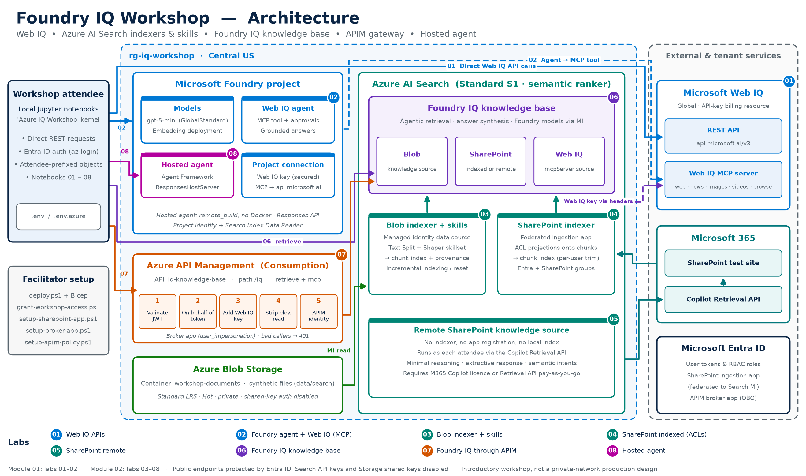

# Web & Foundry IQ Workshop

## Overview

Build agents that search the web and answer questions over your own documents. These hands-on labs start with direct API calls, then introduce agents, search indexes, SharePoint permissions and Foundry IQ.

You can take one track or work through the whole workshop. The notebooks show the requests and responses directly, so you can see how the pieces fit together.

*Illustrative diagram from an earlier eight-lab layout. Use the [lab guide](docs/labs/README.md) for current 01-14 numbering and the [deployment guide](infra/README.md) for the current region and existing-APIM setup.*

## Let's get started

| Your role | Where to begin |
|---|---|
| **[Participant](docs/participants/README.md)** | Ask your facilitator for the workshop configuration and access, then [open the notebooks](docs/participants/README.md). You do not need to deploy your own Azure resources. |
| **[Facilitator](docs/facilitators/README.md)** | Review [Prepare for the workshop](PREPARE-FOR-WORKSHOP.md), then follow the [beginner deployment guide](infra/README.md). Arrange approvals and licenses before class. |
| **[Learning on your own](docs/self-guided/README.md)** | Follow the facilitator setup once, then use the participant instructions. You need your own eligible Azure subscription and access to the services you choose. |
| **[Tenant / SharePoint administrator](docs/facilitators/sharepoint.md#administrator-handoff-approve-permissions-and-site-read-once)** | Review the SharePoint permissions and one-time approval handoff for lab 07; attendees do not need tenant administrator roles. |

**New to Azure?** The [infrastructure guide](infra/README.md) explains the tools, subscription, resource group, deployment command and costs from the beginning.

## Choose your code

**Choose Python or C#:** Python developers can use the [Jupyter notebooks](python-notebooks) for all labs. C# developers can explore lab 01 in an optional [Polyglot Notebook](c-sharp-notebooks/01-web-iq-apis.dib) or a [.NET 10 console app](c-sharp-console-apps/01-web-iq-apis). Polyglot Notebooks uses deprecated tooling; the console app is the supported C# option. See the [language setup guide](docs/participants/README.md#choose-your-language).

## Workshop guides

Jump to: [Lab guide](docs/labs/README.md#choose-your-labs) | [Deployment](docs/facilitators/README.md#1-deploy) | [Local setup](docs/participants/README.md) | [Troubleshooting](docs/reference/README.md#troubleshooting) | [Cleanup](docs/reference/README.md#cleanup)

The detailed setup, permissions, commands, costs and validation notes are in the linked guides.
