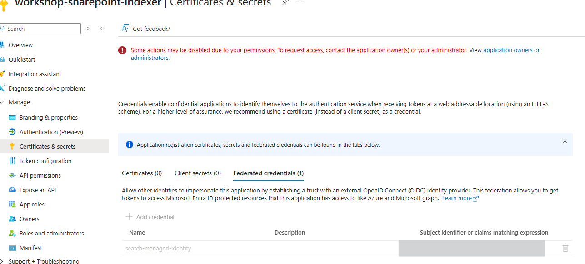

# Lab 07 - SharePoint indexing, Content Understanding, embeddings and Entra ACLs

[C# notebook](../../c-sharp-notebooks/07-sharepoint-indexed.ipynb) | [Canonical Python notebook](../../python-notebooks/07-sharepoint-indexed.ipynb) | [Remote SharePoint lab 08](../08-sharepoint-remote/README.md) | [Foundry IQ lab 11](../11-foundry-iq-knowledge-base/README.md)

This **dependency-free .NET 10 console app** ports Python07's text-only Search pipeline. Search reads the test site's default document library using the existing secretless ingestion app, Content Understanding produces semantic Markdown sections, embeddings populate vectors, and **every chunk inherits Entra user/group ACLs**. No new app registration, consent, secret, site grant, Graph administration or document upload happens in this app.

Run from the repository root:

```powershell
dotnet run --project .\c-sharp-console-apps\07-sharepoint-indexed -- --help
# Only after reviewing/completing the existing app setup described below:
dotnet run --project .\c-sharp-console-apps\07-sharepoint-indexed -- run --setup-confirmed
```

**`run --setup-confirmed` writes all four Search objects, starts billable ingestion, waits and queries visibility once.** Separate commands let you inspect each stage. No automatic cleanup, permissions resync, paid rerun or retry is performed.

## Prerequisites: the identities are different

Use a **dedicated, non-sensitive test site/library** in the workshop tenant. Complete [SharePoint indexer preview registration](https://aka.ms/azure-cognitive-search/indexer-preview) and review [preview limitations](https://learn.microsoft.com/azure/search/search-how-to-index-sharepoint-online), including Conditional Access incompatibilities, unsupported guest ACLs and unsupported Entra groups nested inside SharePoint groups. Do not disable tenant security policies to make this lab work.

| Identity | Permission / purpose |
|---|---|
| Your setup user | **Search Service Contributor** on Search to create/update its objects; Azure CLI sign-in to the workshop tenant. Azure subscription Owner does not replace Entra/SharePoint authorization. |
| Each query user | **Search Index Data Reader** on Search plus actual access to source SharePoint documents. Test two non-admin member accounts, not guests or application identities. |
| Ingestion app | Microsoft Graph **Application** permissions `Files.Read.All` and `Sites.Selected`, admin consent, and explicit **Read** on the selected site. |
| Search system-assigned identity | Federated trust on that ingestion app; **Cognitive Services User** on the parent Foundry resource for keyless Content Understanding and embeddings. Workshop Bicep declares the model/enrichment grant. |
| One-time app administrator | App-management permission/ownership, authorized admin consent and selected-site-grant permissions, as detailed in Python07 and the setup script. These are not ordinary query-user requirements. |

`Sites.Selected` does **not** narrow the separate tenant-wide Graph `Files.Read.All` grant. The selected site URL/default library limits this indexer's crawl, not the app's underlying authorization. Review this permission combination with the tenant administrator; it is not strict site-only app isolation.

Reuse the existing configured app, such as `iq-workshop-sharepoint-indexer`, and `scripts\setup-sharepoint-app.ps1`. One configured app can serve multiple indexes on this Search service. Run setup in a separate PowerShell terminal, not from the console app:

```powershell
.\scripts\setup-sharepoint-app.ps1 -AppName 'iq-workshop-sharepoint-indexer' `
  -SiteUrl 'https://<tenant>.sharepoint.com/sites/<workshop-site>'
```

The delegated site-grant path needs Graph delegated `Sites.FullControl.All`, SharePoint Administrator (or higher) and target-site membership; unauthorized preflight stops before app changes. Tenant admin consent requires Privileged Role Administrator or Global Administrator for the Graph application permissions. Consent and the selected-site grant are separate states/tasks.

Python07 documents the explicit administrator-only `-BootstrapSiteAccess -GrantAdminConsent` alternative, including its temporary credential/permission cleanup risks. **This app never invokes bootstrap or escalates permissions**, and never creates a secret or duplicate app. Reuse existing broader grants only after administrator review; do not silently copy every permission from screenshots.

### Federation and client IDs



The ingestion app trusts Search's **system-assigned managed identity** through an Entra federated credential, with that identity's principal/object ID as subject and `api://AzureADTokenExchange` as audience. Search exchanges its proof for an app token; the app's grants determine ingestion access. Federation does not grant site access or change a querying user's document permissions.

| Identifier | Where it belongs |
|---|---|
| Ingestion app **client/application ID** | `SHAREPOINT_APP_CLIENT_ID`; connection string `ApplicationId`. |
| Search identity **client/application ID** | `SHAREPOINT_SEARCH_MI_CLIENT_ID`; `FederatedCredentialApplicationId`. |
| Search identity **principal/object ID** | Federated credential's subject, **not** the above setting. |
| Ingestion app object ID / federated credential object's own ID | Administrative objects, **not** ingestion connection IDs. |

The two configured client IDs must be valid, distinct GUIDs. Acknowledging `--setup-confirmed` confirms your review, **not an automated federation/consent/site-access check**. A successful data-source PUT does not prove ingestion access.

## Settings, names and dependencies

Install .NET 10 and Azure CLI, then `az login --tenant <AZURE_TENANT_ID>`. No Python, notebook extension or extra NuGet packages are needed for the console.

Root `.env` loads first, then `.env.azure`; both override environment values, with `.env.azure` winning. Simple quoted `KEY=VALUE`, comments and `export` prefixes are supported; interpolation/multiline values are not.

| Setting | Meaning |
|---|---|
| `WORKSHOP_PREFIX` | Required; 3-20 lowercase letters/digits, beginning with a letter, such as `alice01`. |
| `AZURE_TENANT_ID` | Workshop tenant GUID; Search/SharePoint should be in the same tenant. |
| `AZURE_SEARCH_ENDPOINT` | Public-cloud HTTPS Search endpoint, without path/query/credentials. |
| `SHAREPOINT_SITE_URL` | Public-cloud SharePoint HTTPS **site URL**, not a file/sharing link; no credentials/query/fragment. |
| `AZURE_AI_ACCOUNT_NAME` | Existing Foundry account name, not endpoint. CU needs a supported region, normally East US. |
| `AZURE_AI_EMBEDDING_DEPLOYMENT_NAME` | Existing text-embedding deployment, normally `workshop-embedding`. |
| `AZURE_AI_EMBEDDING_MODEL_NAME` | Optional; defaults to `text-embedding-3-small`; fixed **1536 dimensions**, matching Python07. |
| `SHAREPOINT_APP_CLIENT_ID` | Existing ingestion app client ID; needed for `configuration`, `data-source` and full `run`. |
| `SHAREPOINT_SEARCH_MI_CLIENT_ID` | Search managed identity client ID; needed for those same commands. |

The index, source, skillset and indexer are `<prefix>-nb7-index`, `<prefix>-nb7-ds`, `<prefix>-nb7-skillset`, `<prefix>-nb7-indexer`, matching Python07 and lab 11. Existing `<prefix>-sp-*` objects are untouched. Python and C# with the same prefix target **the same objects**; names prevent collisions, not enforce access isolation.

This lab needs no Blob, chat deployment, APIM, Web IQ key or earlier indexing lab. Query users do not need the ingestion app IDs. Base workshop/site/model settings still load; they are public configuration, not app credentials.

## Run one task at a time

| Command | Action and result |
|---|---|
| `configuration` | Validate settings and distinct ingestion client IDs **offline**. No token, Graph/ARM check, file write or Search request. |
| `data-source --setup-confirmed` | PUT the secretless SharePoint source; `defaultSiteLibrary`, `indexerPermissionOptions=['userIds','groupIds']`. No indexer run or app setup. |
| `index` | PUT the Entra ACL-aware text/vector index. No source/skillset creation or document query. |
| `skillset` | PUT Content Understanding, text embeddings and ACL-preserving projections. Does not run extraction or silently create its target index. |
| `indexer --setup-confirmed` | Read existing status; reject an active run before changing anything. PUT the indexer; creation starts ingestion. For an existing idle indexer, explicitly POST a new run. No schedule, waiting or query. |
| `status` | GET/pretty-print current status once. No new run, resync, query or local checkpoint read. |
| `wait` | Monitor the requested run using a saved metadata checkpoint, or current last result without one. Up to 90 reads, 10 seconds apart; rejects failures/failed documents and prints warnings. **No rerun on timeout**. |
| `query [question]` | POST one ACL-aware query, default `'*'`, `count=true`, `top=5`. Uses a fresh delegated CLI-user Search token for both authorization purposes; pretty-prints content/source/page fields. No indexer/setup writes or retries. |
| `run-indexer` | Explicitly request another billable run of the existing idle indexer; capture its previous start time. No waiting, query or ACL resync. |
| `resync-permissions --confirm` | Explicitly POST `{'options':['permissions']}` to this indexer's `/resync`, then `/run`. Requires idle status; no content reset, waiting, query or site permission change. |
| `run --setup-confirmed` | Perform all setup, ingestion, waiting and one wildcard query. Separate commands need not already have run. Repeated full runs update objects and explicitly rerun ingestion. |
| `cleanup --confirm` | Preflight/delete only the four matching prefixed Search objects, in dependency order. Skip 404; never ignore 403/conflicts or force-delete. Preserve app/site grants and source files. |
| `help`, `--help`, `-h`, no arguments | Show help before settings/authentication/state access. Fully offline. |

```powershell
dotnet run --project .\c-sharp-console-apps\07-sharepoint-indexed -- configuration
dotnet run --project .\c-sharp-console-apps\07-sharepoint-indexed -- data-source --setup-confirmed
dotnet run --project .\c-sharp-console-apps\07-sharepoint-indexed -- index
dotnet run --project .\c-sharp-console-apps\07-sharepoint-indexed -- skillset
dotnet run --project .\c-sharp-console-apps\07-sharepoint-indexed -- indexer --setup-confirmed
dotnet run --project .\c-sharp-console-apps\07-sharepoint-indexed -- status
dotnet run --project .\c-sharp-console-apps\07-sharepoint-indexed -- wait
dotnet run --project .\c-sharp-console-apps\07-sharepoint-indexed -- query
dotnet run --project .\c-sharp-console-apps\07-sharepoint-indexed -- query "receipts"
# Only when intentionally rerunning/refreshing permissions:
dotnet run --project .\c-sharp-console-apps\07-sharepoint-indexed -- resync-permissions --confirm
dotnet run --project .\c-sharp-console-apps\07-sharepoint-indexed -- wait
```

## Read the code and results

`SharePointSettings.cs` loads/validates public settings and builds the four-ID connection string. `SharePointTransport.cs` acquires fresh Search-audience Azure CLI tokens and makes REST requests (`2026-08-01-preview`) without API keys. `SharePointWorkshop.cs` contains visible payload builders and individual actions; `Program.cs` routes one named command.

The index has `permissionFilterOption='enabled'`, non-retrievable `UserIds`/`GroupIds` permission-filter collections and the exact non-retrievable `metadata_spo_item_path`. `content` is Markdown; `contentVector` is not returned in ordinary results. The matching vectorizer/embedding skill use the existing deployment/model and 1536 dimensions.

Content Understanding uses **semantic, token-based sections up to 800 tokens with zero overlap**, plus `locationMetadata` for page ranges. It is not the character-based Blob lab's split and is not chat/answer generation. No Vision/vectorizer, Text Split, image projection, custom Web API skill, knowledge store, enrichment cache or debug session is added.

`skipIndexingParentDocuments` means **every chunk's projection** must carry `/document/metadata_user_ids` and `/document/metadata_group_ids`, the source item path and page/source metadata. Parent-only field mappings would lose ACLs on searchable chunks.

### Monitor the right run

The console saves only Search endpoint, indexer name and prior run start time in ignored **`.workshop\lab07-<prefix>.json`** when creating/requesting ingestion. This binds monitoring to the correct service/indexer and stops an old successful result from masquerading as the new run. No documents, vectors, tokens, secrets or user identities are saved.

`wait` can be run in a new process after `indexer`/`run-indexer`/`resync-permissions`. Without a checkpoint it reports the current last result, not proof that a newly requested run completed. A timeout/failure does not reset, resync or rerun anything; inspect `status`. Warnings and zero processed items warrant review; ingestion success is not proof of valid user/group trimming.

### Query identities and readable output

`Authorization: Bearer <Search token>` authenticates access to Search. **`x-ms-query-source-authorization: <same user token>`** supplies the end-user document ACL identity. Their purposes differ, though this local lab uses the same freshly acquired user token for both, avoiding a mid-request identity mismatch. There is **no `x-ms-enable-elevated-read`** or app-only query fallback.

The local token-claim check rejects obvious app-only/wrong-tenant/wrong-audience tokens before querying; **it is not JWT signature validation or an authorization boundary**. Azure AI Search validates the token and enforces permissions. Use member-user `az login`, not service-principal sign-in.

Start with wildcard visibility before relevance queries. Pretty JSON keeps scores/count/content/page/source fields readable; original document URLs require the viewer's own SharePoint access. Empty results can be valid, not automatic ingestion/authentication failure.

HTTP failures report status, UTC date, available correlation/request IDs and a bounded token-redacted body. Invalid JSON/partial HTTP responses, active-run conflicts, failed documents and indexer failures stop rather than become empty successes. No automatic paid retries. Outputs can contain private document text/URLs: clear them before sharing.

## Prove permission trimming; refresh deliberately

Use two **non-admin member accounts** with Search Index Data Reader, the same index and query. Confirm actual access by opening the restricted document in SharePoint. Account A should retrieve it; account B must not have another access path via a sharing link, group or site-admin privilege. Sign out/in to Azure CLI and restart a notebook kernel between users.

Test direct user grants first, then **Entra groups assigned directly to documents**. Remove A's direct grant before the group-only test so it cannot conceal group-resolution failure. The lab does not expand native `spg:` SharePoint groups, guest ACLs, special owners claims or unsupported nested groups; do not claim complete SharePoint permission-model parity.

Item-level unique ACL changes refresh on successful runs. **Inherited site/library/folder ACL changes require explicit permissions resync (or supported document reset), followed by a run**; then monitor and query again. A changed skillset instead requires content reprocessing, not merely an ACL resync. The app never changes SharePoint permissions automatically.

## Optional legacy notebook

Use the C# kernel with working directory **`c-sharp-notebooks`**. BCL settings/transport helpers are inline; no other notebook, console import, SDK package or Python runtime is needed for the VS Code notebook path. The numbered cells show Python07's actual JSON payloads and REST calls for data source, index, skillset, indexer, monitor and user queries, rather than calling console workflow methods.

Run setup cells **1a imports, 1b settings helper, 1c REST helper, then 1d configuration** in that order. Select **csharp - C# Script** in the Polyglot cell kernel selector, while keeping the VS Code cell language set to **Polyglot Notebook**. Plain C# editor cells are not supported by the .NET Interactive controller. The helper definitions must run before configuration uses `SharePointSettings` or `SharePointTransport`; rerun all four after restarting the kernel.

`INDEXED_SETUP_CONFIRMED = true` matches Python07's reviewed-setup acknowledgment; review the completed administrator setup before ingestion and set it false if setup is incomplete. This does not test permissions. `RUN_AGAIN`, `RESYNC_PERMISSIONS` and `CLEAN_UP` default to false. The notebook keeps prior run metadata **only in kernel memory**; no console cache is written. After restart, monitoring observes the current last result unless you deliberately request/capture another run. Notebook cleanup follows Python07's direct, opt-in deletes of the four named Search objects; the console additionally preflights matching resource definitions.

## Cleanup, costs and offline checks

```powershell
dotnet run --project .\c-sharp-console-apps\07-sharepoint-indexed -- cleanup --confirm
```

Cleanup preflights names/targets, ACL index shape and secretless source identity/site before deleting indexer, skillset, index and data source. Repurposed definitions stop before deletion; already-missing objects are skipped. It removes only this matching console checkpoint after successful cleanup. No resource group, other `<prefix>-sp-*` objects, source files, app/service principal, federation, consent or selected-site grant are removed.

Tenant/app cleanup is an independent authorized administrative workflow, after checking whether other indexes share the app. App registrations are not deleted by deleting an Azure resource group. Remove only dedicated test content/site and unused test-app grants. Search storage/compute, Content Understanding and embeddings incur charges; stopping the terminal does not delete resources, and an analysis timeout can still be billable.

```powershell
dotnet build .\c-sharp-console-apps\07-sharepoint-indexed\SharePointIndexed.csproj
dotnet run --project .\tests\c-sharp-sharepoint-indexed
$env:PYTHONPATH = '.\tests'
.\.venv\Scripts\python.exe -m unittest test_csharp_sharepoint_indexed_notebook.SharePointIndexedConsoleTests test_csharp_sharepoint_indexed_notebook.SharePointIndexedNotebookTests -v
dotnet format .\c-sharp-console-apps\07-sharepoint-indexed\SharePointIndexed.csproj --verify-no-changes --no-restore
dotnet format .\tests\c-sharp-sharepoint-indexed\SharePointIndexedTests.csproj --verify-no-changes --no-restore
```

These tests use synthetic HTTP/tokens and actual inline cells, comparing current Python07 payloads, ACL projections, identity headers, confirmation guards, run checkpoints, failures and scoped cleanup. They do not exercise a live SharePoint tenant or prove real two-user ACL trimming. Optional kernel checks need the existing Python test environment and deprecated .NET Interactive tooling. No live Azure/Graph/SharePoint call or permission change is made.

## References

- [Original setup-index sample](https://github.com/memasanz/foundry-iq-sharepoint-indexer/blob/main/notebooks/01_setup_index.ipynb)
- [SharePoint ACL permissions, identifiers and refresh](https://learn.microsoft.com/azure/search/search-indexer-sharepoint-access-control-lists)
- [Query-time permission enforcement](https://learn.microsoft.com/azure/search/search-query-access-control-rbac-enforcement)
- [Content Understanding skill](https://learn.microsoft.com/azure/search/cognitive-search-skill-content-understanding)
- [Microsoft Graph selected-site grants](https://learn.microsoft.com/graph/api/site-post-permissions)
