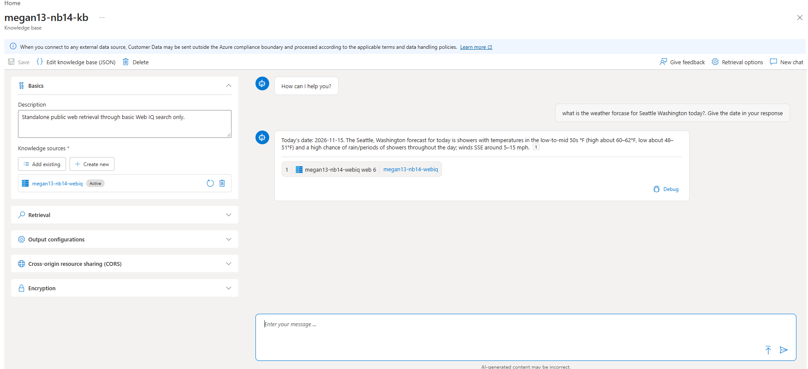

# 09 — Foundry IQ with Web IQ only (.NET 10)

**Basic Web IQ `web` tool -> MCP knowledge source -> Web-only knowledge base ->
Search retrieval, with cited passages and optional answer synthesis.** This is the
standalone console equivalent of [Python09](../../python-notebooks/09-foundry-iq-webiq-only.ipynb).
The [C# notebook](../../c-sharp-notebooks/09-foundry-iq-webiq-only.ipynb) contains all
helpers and visible per-step JSON inline, with no console imports or previous-lab dependency.
It requires Polyglot Notebooks/C# .NET Interactive and a kernel working directory
of `c-sharp-notebooks`; console commands instead run from the **repository root**.

Direct BCL `HttpClient`/`JsonNode` REST and Azure CLI tokens follow labs 05/06/08.
No NuGet packages, APIM, Blob, SharePoint, indexes, ingestion, agents, deployment,
permission grants, prompts, persistent cache or automatic paid retries are involved.

## Prerequisites, settings and authentication

1. Install .NET 10 SDK and Azure CLI. Reuse an existing Azure AI Search service,
   parent Foundry resource/chat deployment and Web IQ profile with a valid API key.
   Configure networking so your process can reach Search and Search can reach
   the model and Web IQ. No earlier notebook is required.
2. Set the following in untracked repository-root `.env` and/or `.env.azure`.
   `.env` loads first, then `.env.azure`; **both override environment variables**,
   and `.env.azure` wins. See [settings example](../../.env.example).
3. Run `az login --tenant <AZURE_TENANT_ID>`. Do not print/paste tokens or keys.
   Settings validate before token acquisition and writes.

| Setting | Required value |
|---|---|
| `WORKSHOP_PREFIX` | 3–20 lowercase letters/digits starting with a letter, e.g. `alice01`; required, no default/prompt. |
| `AZURE_TENANT_ID` | Tenant GUID in standard hyphenated form. |
| `AZURE_SEARCH_ENDPOINT` | Public HTTPS Azure Search service root, e.g. `https://my-search.search.windows.net`; no credentials/path/query/fragment/custom port. |
| `AZURE_AI_ACCOUNT_NAME` | Parent Foundry account name; model URI is `https://<account>.openai.azure.com`. |
| `AZURE_AI_MODEL_DEPLOYMENT_NAME` | Existing chat deployment, not an embedding deployment. |
| `AZURE_AI_MODEL_NAME` | Optional; defaults to `gpt-5-mini`. Match the deployed model. |
| `WEBIQ_API_KEY` | Valid Web IQ profile key; stored only in the source's `storedHeaders` `x-apikey`. |

| Function | Required access |
|---|---|
| Source/base create, update, delete | Search Service Contributor on Search. |
| Retrieve | Search Index Data Reader or Search Index Data Contributor on Search. |
| Search invokes chat deployment | Search managed identity needs Cognitive Services User or equivalent inference access on the parent Foundry resource. |
| Web IQ searches | Valid Web IQ profile API key and available profile quota/billing. |

The CLI token scope is **`https://search.azure.com/.default`**, matching Python09.
Search requests send only `Authorization: Bearer <Search token>`, never a Web IQ
API-key header or SharePoint query-user authorization header. Token acquisition
allows 60 seconds and disposes each CLI process/timeout. CLI errors occur before
Search/Web IQ and are not evidence that the Web IQ key is invalid. To test token
acquisition without printing its value:

```powershell
az account get-access-token --tenant '<tenant-id>' --resource https://search.azure.com --query expiresOn --output tsv
```

The legacy resource names **`<prefix>-nb14-webiq` and `<prefix>-nb14-kb`** are
deliberately retained even though this is lab 09. PUT reruns update/reuse those
objects, including the stored key. Prefixes avoid collisions, **not enforce
access isolation**. Restrict source-authoring access: the key belongs to the
source, not a chat or knowledge base; authorized callers share its quota/billing.
Rotate it in Web IQ and rerun `source`; revoke it when no longer needed.
Never print the source payload or key-containing settings; clear notebook outputs
before sharing. Returned passages/URLs can also contain sensitive information.

## Run one step at a time

All commands run from the **repository root**. REST API **2026-08-01-preview**;
payloads in `WebIqWorkshop.cs` match the current Python09 baseline. Each command
does **only its named action** with no hidden prerequisite creation or retrieval.

| Command | What it does / expected result | Prerequisites/dependencies | Writes and billable effects |
|---|---|---|---|
| `source` | PUT only the named MCP source; reports ready, `storedHeaders`, tool `web`. Updates stored key on rerun. | Settings, Search sign-in/management role, Web IQ profile key. | Resource write; no retrieval/model call. |
| `knowledge-base` | PUT only the base referencing the named source, existing chat deployment, low reasoning, default `answerSynthesis`. Reports base ready. | Existing `source`, settings and Search management role; model/MI access configured. | Resource write; no retrieval/model inference at this step. |
| `retrieve [query] [--output-mode answerSynthesis\|extractiveData]` | POST once to existing base; prints HTTP/request ID, activity, answer/extractive text, reference URLs and passages. Rejects partial/source failures. | Existing source/base, settings, Search query role, Search MI inference access and working Web IQ key/profile. | No configuration write; **billable Web IQ retrieval, model planning, reranking; synthesis for answerSynthesis**. |
| `run [query] [--output-mode answerSynthesis\|extractiveData]` | Source PUT, base PUT, one retrieve POST in order. Keeps resources; no probe or cleanup. | All runtime settings/roles/model/profile prerequisites; earlier separate commands are **not** required. | Both resource writes plus same retrieval/model billing as above. |
| `diagnostics` | Print UTC, .NET version, endpoint/names and only proxy environment presence. | Local settings only; no Azure sign-in required. | Local read-only; no tokens/HTTP/model calls. |
| `connectivity` | **Optional troubleshooting** unauthenticated GET; HTTP 401 expected. Reports response, not permissions/KB/Web IQ readiness. | Settings, ability to reach Search over HTTPS; no sign-in required. | Read-only GET; no credentials, Web IQ or model call. |
| `cleanup --confirm` | DELETE exact legacy knowledge base then source; 404 tolerated, other failures stop. Reports absent/deleted. | Settings, Search management role; explicit confirmation. | Destructive configuration writes only; no retrieval/model calls. |
| `help` / `--help` / `-h` / no arguments | Print command usage. | None; works offline before dotenv/auth. | No settings reads, cache, tokens or HTTP. |

Ordered independent steps:

```powershell
dotnet run --project c-sharp-console-apps\09-foundry-iq-webiq-only -- help
dotnet run --project c-sharp-console-apps\09-foundry-iq-webiq-only -- source
dotnet run --project c-sharp-console-apps\09-foundry-iq-webiq-only -- knowledge-base
dotnet run --project c-sharp-console-apps\09-foundry-iq-webiq-only -- retrieve
dotnet run --project c-sharp-console-apps\09-foundry-iq-webiq-only -- retrieve "What is the latest stable Python release and its release date, according to Python.org?" --output-mode extractiveData
```

Or execute the clean full normal workflow independently:

```powershell
dotnet run --project c-sharp-console-apps\09-foundry-iq-webiq-only -- run
```

`run`/`retrieve` accept one quoted, non-empty query and validated output mode.
The default is Seattle weather with **today's UTC date**, not a hard-coded
forecast. The per-request mode does not update the stored base. Changing to
`extractiveData` performs another billable retrieval, still with model planning;
results can differ between requests. A missing resource causes an informative
server error, not automatic recreation or an extra paid query.

## API/tool choice, evidence and portal

Exactly one tool **`web`** is exposed, with `outputParsing: {"kind":"auto"}` and
`maxOutputTokens: 4000`. `auto` is Search's parser, **not** the Web IQ Auto tool.
There is no separate `news` tool. Source/retrieval instructions explicitly ask
for `contentFormat: passage`; this is planner guidance, not an enforced server
parameter override. Retrieval requests include messages, `includeActivity`,
60-second maximum runtime, source references and reference source data.

Inspect the printed MCP activity and retrieved passages, not just the fluent
answer. Nested JSON reference content is parsed to expose title, URL and passage.
Check requested place/date/fact against evidence; citations do not prove accuracy.

| Evidence | Interpretation |
|---|---|
| Search HTTP 401/403 | Check Search sign-in, tenant, RBAC and network access, not automatically Web IQ authentication. |
| MCP `auth_missing_token` | Stored Web IQ key was not accepted. Check profile/key and rerun `source`. This lab does not use APIM injection. |
| Other MCP source error / HTTP 206 | Failed or partial retrieval; inspect activity. For content-format errors check `passage`. App fails, without retry. |
| No references | Check activity/query/location/date; this alone does not establish authentication failure. |
| Relevant evidence but answer claims it cannot search | Compare passages and `extractiveData`, not answer wording alone. |

In Foundry IQ portal select this Search service and **`<prefix>-nb14-kb`**.
When selecting sources for another base, choose **`<prefix>-nb14-webiq`**, not
the keyless `iq-workshop-webiq` APIM source. Stored authentication enables portal
retrieval; each portal question is a separate billable live retrieval request.



The screenshot shows the single active Web IQ source and weather reference.
Its prefix, **date and weather answer are illustrative** and differ from your run.
The **`nb14` legacy names** retain the original numbering; this is now lab 09.
Only **`web`**, not a separate **`news`** tool, is configured. Verify cited passages.

## Optional troubleshooting, diagnostics and cleanup

HTTP failures print status, UTC Date, request/correlation/trace identifiers and
a bounded redacted body (8,000 characters), then fail. Key and bearer-token echoes
are redacted in both failures and successful activity/text/reference output.
HTTP 206 and MCP activity errors are rejected, not presented as empty success.
No automatic paid retry or permission/billing change occurs.

For repeated connection resets/TLS errors only:

```powershell
dotnet run --project c-sharp-console-apps\09-foundry-iq-webiq-only -- diagnostics
dotnet run --project c-sharp-console-apps\09-foundry-iq-webiq-only -- connectivity
```

The probe sends **no Authorization or API-key header** and does not acquire a token.
**HTTP 401 is expected** and confirms an HTTPS response, not Search permissions,
knowledge-base existence or Web IQ readiness. Any other HTTP response also only
confirms a response. A connection/TLS error means no usable response. A successful
console probe does not resolve failures in the notebook kernel: enable its
`CHECK_CONNECTIVITY = false` cell only in the failing kernel. Never disable TLS
verification or bypass organizational proxy controls; proxy flags print no values.

Resources remain available until explicit opt-in deletion:

```powershell
dotnet run --project c-sharp-console-apps\09-foundry-iq-webiq-only -- cleanup --confirm
```

Without exactly `--confirm`, cleanup refuses before settings/auth. It deletes
**only** `<prefix>-nb14-kb` then `<prefix>-nb14-webiq`; no shared Search/model,
Web IQ profile/key, indexes or other-lab resources. Notebook `CLEAN_UP = false`
is disabled by default. Its final client disposal releases local resources only.

## Offline validation

Run sequentially; no live Azure/Web IQ requests or deployments:

```powershell
dotnet build c-sharp-console-apps\09-foundry-iq-webiq-only
dotnet run --project tests\c-sharp-webiq-only
python -m unittest discover -s tests -p test_csharp_webiq_only_notebook.py
dotnet format c-sharp-console-apps\09-foundry-iq-webiq-only --verify-no-changes
dotnet format tests\c-sharp-webiq-only --verify-no-changes
```

The notebook suite uses existing optional .NET Interactive infrastructure to execute
actual isolated inline cells with synthetic HTTP/token providers and compare
current Python09 payloads. Tests also execute the real entrypoint's help aliases
offline before configuration/auth, validate partial errors, redaction, independent
steps, opt-in probe and cleanup scope/order. Missing optional tooling is reported.

## References

- [MCP knowledge sources/authentication](https://learn.microsoft.com/azure/search/agentic-knowledge-source-how-to-mcp-server)
- [Create a knowledge base](https://learn.microsoft.com/azure/search/agentic-retrieval-how-to-create-knowledge-base)
- [Retrieve action](https://learn.microsoft.com/azure/search/agentic-retrieval-how-to-retrieve)
- [Answer synthesis/output modes](https://learn.microsoft.com/azure/search/agentic-retrieval-how-to-answer-synthesis)
