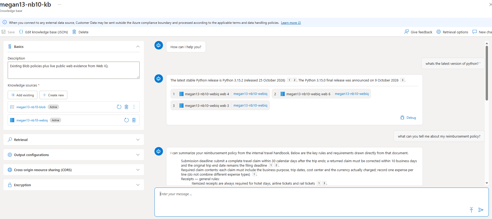

# 10 — Foundry IQ: Web IQ + Content Understanding Blob (.NET 10)

Standalone equivalent of [current Python10](../../python-notebooks/10-foundry-iq-webiq-blob.ipynb).
The [C# notebook](../../c-sharp-notebooks/10-foundry-iq-webiq-blob.ipynb) has self-contained
inline helpers and visible REST payloads: no console imports. Use Polyglot Notebooks /
C# .NET Interactive with kernel directory `c-sharp-notebooks`. Console commands run
from the **repository root** using .NET 10 and Azure CLI, without NuGet dependencies.

## Existing resources, permissions and settings

Complete [05 — Content Understanding](../05-blob-content-understanding/README.md)
with the same prefix first. The existing **`<prefix>-cu-chunks`** index must contain
visible enriched Blob chunks, retrievable `chunk_id`, `chunk`, `title`,
`source/file_name`, `source/url`, searchable `chunk` and `chunk-semantic`.
This lab only reads that index's schema/count; it never uploads files, embeds documents,
creates or changes indexes/indexers/skillsets/data sources, or modifies its semantic
configuration/vectorizer. No SharePoint, APIM, broker, agent or adjacent KB is required.

Reuse an existing Search service, Foundry account and chat deployment, Search managed
identity and authorized Web IQ profile key. Configure networking so your process reaches
Search and Search reaches the existing models and Web IQ.

| Identity / function | Prerequisite |
|---|---|
| Signed-in user: source/KB authoring and cleanup | **Search Service Contributor** on Search. |
| Signed-in user: existing index schema/count and retrieval | **Search Index Data Reader** (or **Search Index Data Contributor**) on Search. |
| Search managed identity: chat planning/synthesis and existing vectorizer | **Cognitive Services OpenAI User** on the Foundry account; existing model/vectorizer inference permissions. |
| Web IQ profile manager / calls | Authority to issue an authorized profile key; valid key, profile quota and billing. |

Load untracked repository-root `.env` **then `.env.azure`**; both override stale
environment variables and `.env.azure` wins. No prefix prompt, infrastructure detection
or cross-process cache. See [settings example](../../.env.example).

| Setting | Value |
|---|---|
| `WORKSHOP_PREFIX` | Required: 3–20 lowercase letters/digits, starting with a letter. |
| `AZURE_TENANT_ID` | Required: tenant GUID. |
| `AZURE_SEARCH_ENDPOINT` | Required: public HTTPS Search service root, e.g. `https://my-search.search.windows.net`; no credentials/path/query/custom port. |
| `AZURE_AI_ACCOUNT_NAME` | Required: existing Foundry account name; model URI `https://<account>.openai.azure.com`. |
| `AZURE_AI_MODEL_DEPLOYMENT_NAME` | Required: existing chat deployment, not embeddings. |
| `AZURE_AI_MODEL_NAME` | Optional, default `gpt-5-mini`; match the deployed chat model. |
| `WEBIQ_API_KEY` | Required: authorized Web IQ profile key; stored in the source's `storedHeaders` `x-apikey`. |

Sign in with `az login --tenant '<AZURE_TENANT_ID>'`. Search REST requests use
`Authorization: Bearer <Search token>` for scope **`https://search.azure.com/.default`**
and API **`2026-08-01-preview`**. Search receives no Web IQ key header or SharePoint
user header; only the Web IQ source PUT contains its stored key. Model configuration
uses the existing account/deployment/model and Search MI, without a model API key.

Names are exactly **`<prefix>-nb10-blob`, `<prefix>-nb10-webiq`, `<prefix>-nb10-kb`**.
PUT reruns update those definitions, not neighboring labs. Prefixes avoid collisions,
not enforce access isolation. Source-author permissions expose the stored profile key:
restrict access, rotate it and rerun `webiq-source`; never print/export the source response
or key-containing settings. Shared profile calls share quota/billing.

## Run one step at a time

Each command performs **only its named action**, with no hidden prerequisite creation
or paid retrieval. Payloads are direct, readable `JsonObject` REST in `WebIqWorkshop.cs`.

| Command | Action / expected result | Required earlier steps / prerequisites | Writes / billing |
|---|---|---|---|
| `verify-index` | GET existing CU schema, then count-only POST `{"search":"*","count":true,"top":0}`. Reports visible chunks and unchanged schema; missing schema/semantic config or empty data fails. | Populated lab05 CU index; settings, sign-in and Search data role. | Read-only, no indexing/embedding/Web IQ/model calls. |
| `blob-source` | PUT only `nb10-blob` searchIndex source; reports index mapping. | Existing verified CU index, settings and Search author role. | One source definition write; no retrieval. |
| `webiq-source` | PUT only `nb10-webiq` MCP source with stored header; reports `storedHeaders`, tool `web`. | Settings, author role and authorized profile key. | One source definition write; no Web IQ call. |
| `knowledge-base` | PUT only `nb10-kb`, exactly two sources, existing model, low reasoning and `answerSynthesis`. Reports ready. | Both existing sources, settings/author role and Search MI model grants. | One KB write; no implicit retrieval/model inference. |
| `retrieve-blob [query] [--output-mode answerSynthesis\|extractiveData]` | One retrieve POST with only the `searchIndex` source params; reports HTTP/ID, activity, answer/evidence and references. | Existing CU index/sources/KB; Search query role, MI chat/vectorizer access. | No config write; billable retrieval/model/vectorizer inference. |
| `retrieve-web [query] [--output-mode answerSynthesis\|extractiveData]` | One retrieve POST with only the `mcpServer` source params. | Existing sources/KB, Search query role, MI chat access, authorized profile key. | Billable Web IQ and model operations; no config write. |
| `retrieve-mixed [query] [--output-mode answerSynthesis\|extractiveData]` | One POST offering both source-specific params; compare evidence in activity/references. Planner may select only one. | All retrieval prerequisites above. | Billable model/Search/Web IQ operations for sources used. |
| `run [mixed query] [--output-mode answerSynthesis\|extractiveData]` | Verify index, PUT two sources and KB, retrieve default Blob question, default public web question, then mixed question. Keeps resources. | All existing resource, permission and configuration prerequisites; no earlier console command required. | Exactly three config PUTs and three normal retrievals after read-only checks; **never cleanup**. |
| `cleanup --confirm` | DELETE KB first, then Web IQ and Blob sources; tolerate 404, stop on other failures. Reports absent/deleted. | Settings, author role and explicit confirmation. | Deletes **only** this KB and its two definitions; never CU index/files/models/profile or other labs. No retrieval. |
| `help` / `--help` / `-h` / no arguments | Offline usage. | None; before dotenv and authentication. | No settings reads, tokens, HTTP or writes. |

From the repository root:

```powershell
dotnet run --project c-sharp-console-apps\10-foundry-iq-webiq-blob -- help
dotnet run --project c-sharp-console-apps\10-foundry-iq-webiq-blob -- verify-index
dotnet run --project c-sharp-console-apps\10-foundry-iq-webiq-blob -- blob-source
dotnet run --project c-sharp-console-apps\10-foundry-iq-webiq-blob -- webiq-source
dotnet run --project c-sharp-console-apps\10-foundry-iq-webiq-blob -- knowledge-base
dotnet run --project c-sharp-console-apps\10-foundry-iq-webiq-blob -- retrieve-blob
dotnet run --project c-sharp-console-apps\10-foundry-iq-webiq-blob -- retrieve-web
dotnet run --project c-sharp-console-apps\10-foundry-iq-webiq-blob -- retrieve-mixed
dotnet run --project c-sharp-console-apps\10-foundry-iq-webiq-blob -- retrieve-mixed "Compare our internal travel receipt policy with public IRS receipt guidelines; never send internal text to the web." --output-mode extractiveData
```

Or run the full sequence independently:

```powershell
dotnet run --project c-sharp-console-apps\10-foundry-iq-webiq-blob -- run
```

Queries are one quoted, non-empty argument; unknown options, extra arguments and invalid
output modes fail before configuration/authentication. For `run`, an optional query replaces
**only the mixed question**. Defaults match Python10: internal reimbursement receipts,
public IRS travel receipt records, then their comparison. Per-request `extractiveData`
does not change the stored KB and can still require billable model planning. Start at low
reasoning; optionally edit KB `retrievalReasoningEffort` to `medium`, rerun `knowledge-base`
and compare activity/latency/coverage. Each new retrieval incurs its own usage.

## Evidence, errors and portal

Web IQ exposes exactly the basic **`web`** tool, `outputParsing: auto`, 4,000 output
tokens and rerank processing. `auto` is Search parsing, not the Web IQ Auto tool.
Source/KB instructions request **`contentFormat: passage`** on every web call, never
text/html/markdown, and prohibit sending internal document text to Web IQ. This is
planner guidance, not an enforced tool-argument override.

Retrieval includes activity, a 60-second maximum runtime, references and reference source
data. Inspect actual queried source names, counts/errors, IDs, URLs and retrieved
passages (nested JSON content and Blob source URL fields are supported). Fluent answers
are not proof of mixed retrieval; absent references alone do not establish auth failure.

| Failure / observation | Diagnosis |
|---|---|
| Missing/empty CU index, wrong schema or no `chunk-semantic` | Complete lab05 with the same prefix; check ingestion/document access, never rebuild here. |
| Search HTTP401 / 403 | Check CLI sign-in/tenant, Search roles/networking; index reads need the data role. |
| Model/vectorizer authorization errors | Check Search managed identity's inference grants on existing Foundry deployments. |
| Web IQ `auth_missing_token` | Check stored profile key/authorization; rerun `webiq-source` after rotation. Not your Search bearer token. |
| HTTP429 | Quota/throttling; inspect Retry-After and capacity/profile usage. No automatic paid retry. |
| HTTP206 or source activity error | Rejected even if an answer exists; inspect redacted activity before declaring success. |
| Sparse references | Refine public query; inspect activity/evidence, not answer wording alone. |

HTTP failures print UTC Date, request/correlation/trace IDs, Retry-After when present
and a bounded redacted body. Key/token echoes are redacted before truncation in logs,
activity, answers and references; source PUT responses are never displayed.
CLI processes and HTTP messages/responses are disposed; auth has a 60-second timeout,
HTTP a 120-second timeout. No paid retries, TLS bypass or live probes.

In Foundry IQ portal choose `<prefix>-nb10-kb`. The stored Web IQ header enables portal
retrieval too. Every portal question is another live request with model/Web IQ charges.



The two source definitions are `<prefix>-nb10-blob`, referencing lab05's `<prefix>-cu-chunks`,
and `<prefix>-nb10-webiq`. The public Python-release and reimbursement-policy answers
are **two separate questions, not proof of mixed retrieval**. Inspect Debug activity and
references; use the mixed command to test both sources in one request. The screenshot is
illustrative, not current Python-version facts or a required answer; names/dates/results differ.

## Explicit cleanup and offline validation

Keep resources for comparison, or explicitly opt in:

```powershell
dotnet run --project c-sharp-console-apps\10-foundry-iq-webiq-blob -- cleanup --confirm
```

Any other cleanup invocation fails before settings/auth. Notebook `CLEAN_UP = false`
is disabled by default; its final disposal cell only releases local resources.

No live Azure/Web IQ requests in these checks:

```powershell
dotnet build c-sharp-console-apps\10-foundry-iq-webiq-blob
dotnet run --project tests\c-sharp-webiq-blob
$env:PYTHONPATH = 'tests'
python -m unittest test_csharp_webiq_blob_notebook.WebIqBlobConsoleTests test_csharp_webiq_blob_notebook.WebIqBlobNotebookTests -v
dotnet format c-sharp-console-apps\10-foundry-iq-webiq-blob --verify-no-changes
dotnet format tests\c-sharp-webiq-blob --verify-no-changes
```

Tests mock HTTP/auth, compare exact current Python10 payloads, reject schema/empty/partial
results and authorization errors, check redaction, independent steps, offline entrypoint
help and cleanup scope. Actual isolated inline C# cells run when existing optional
.NET Interactive is available; do not install deprecated tooling to run them.

## References

- [MCP sources and authentication](https://learn.microsoft.com/azure/search/agentic-knowledge-source-how-to-mcp-server)
- [Create a knowledge base](https://learn.microsoft.com/azure/search/agentic-retrieval-how-to-create-knowledge-base)
- [Retrieve action](https://learn.microsoft.com/azure/search/agentic-retrieval-how-to-retrieve)
- [Answer synthesis and output modes](https://learn.microsoft.com/azure/search/agentic-retrieval-how-to-answer-synthesis)
