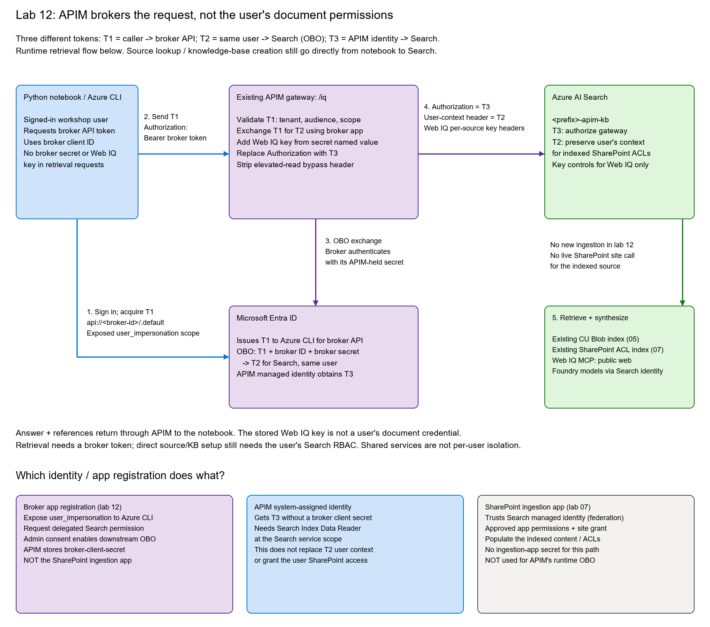

# 12 — Foundry IQ through Azure API Management (.NET 10)

[C# notebook](../../c-sharp-notebooks/12-foundry-iq-apim.ipynb) · [Python canonical lab](../../python-notebooks/12-foundry-iq-apim.ipynb) · [Lab 11 console](../11-foundry-iq-knowledge-base/README.md)

Run from the **repository root**, not this project directory. Install the .NET 10 SDK and Azure CLI; no NuGet packages, azd extensions or automatic login are needed. The notebook is standalone: select a C# kernel, set its working directory to `c-sharp-notebooks`, and run its inline helpers/cells in order. It never imports console sources.

```powershell
dotnet build .\c-sharp-console-apps\12-foundry-iq-apim\Apim.csproj
dotnet run --project .\c-sharp-console-apps\12-foundry-iq-apim -- help
```

## Existing preparation and permissions

Complete lab 11 **without cleanup**, with the same required `WORKSHOP_PREFIX` (3–20 lowercase letters/digits, starting with a letter). Keep `<prefix>-kb-blob`, `<prefix>-kb-sharepoint` and `<prefix>-kb`. This lab creates only `<prefix>-apim-kb`. Prefixes prevent collisions, not enforce access isolation.

The existing gateway, broker and shared keyless Web IQ source must already have been prepared using [setup-broker-app.ps1](../../scripts/setup-broker-app.ps1) and [setup-apim-policy.ps1](../../scripts/setup-apim-policy.ps1), with downstream Search delegated consent approved. The console/notebook **does not run these scripts**, change policies/apps, grant users/roles or create indexes.

**Separately required backend grant:** enable APIM's **system-assigned managed identity**, then on the target **Search service** use **Access control (IAM) > Add role assignment > Search Index Data Reader**, selecting that APIM managed identity. This needs role-assignment permissions and propagation time. The setup scripts do **not** grant this role. A role on APIM or Foundry is not equivalent. A valid broker token/OBO exchange can still result in **403** without this grant.

| Function | Permission |
|---|---|
| Read source definitions; create/update/delete own KB | Search Service Contributor plus Search Index Data Reader (or Search Index Data Contributor) on Search |
| Retrieve at the gateway | Tenant-approved broker delegated `user_impersonation` access; relevant indexed document permissions |
| Gateway backend | APIM managed identity: Search Index Data Reader on the Search service |
| Model calls | Search managed identity: Foundry model inference permission, inherited from lab 11 preparation |

Ownership of the broker application is **not needed for retrieval**. Azure CLI pre-authorization is client permission approval, not user assignment. In an enterprise application with **Assignment required = No**, **Users and groups is not an allowlist**; listing users there does not restrict every other tenant user. With **Yes**, assignments and tenant policies can restrict access. Consent, Conditional Access and indexed document permissions remain separate; no personal tenant details are assumed.

### Settings and dotenv precedence

The app loads root `.env`, then root `.env.azure`, both **overriding process settings**. The notebook uses `Path.GetFullPath("..")` for those same files. Set the prefix in the file that wins; there is no prompt or infrastructure detection.

```dotenv
WORKSHOP_PREFIX=alice01
AZURE_TENANT_ID=<deployment-tenant-guid>
AZURE_SEARCH_ENDPOINT=https://<search-service>.search.windows.net
BROKER_APP_CLIENT_ID=<broker-app-guid>
APIM_GATEWAY_URL=https://<gateway>.azure-api.net
WEBIQ_APIM_SOURCE_NAME=iq-workshop-webiq
```

`WEBIQ_APIM_SOURCE_NAME` defaults to `iq-workshop-webiq` and must match the policy. Neither `WEBIQ_API_KEY` nor a broker secret is required locally. If older labs left secrets in dotenv, output redaction protects them; never paste credentials or diagnostic output into shared tickets. Use an existing `az login --tenant <deployment-tenant-guid>` session, outside the app.

## Architecture and identity flow



[Full-size SVG](../../docs/foundry-iq-apim-architecture.svg) · [Editable Excalidraw source](../../docs/foundry-iq-apim-architecture.excalidraw)

| Identity/app | Role |
|---|---|
| Azure CLI client, `04b07795-8ddb-461a-bbee-02f9e1bf7b46` | Signs in the user; explicitly pre-authorized by the broker setup script for the exposed scope. This is **not** the broker ID or a user assignment. |
| Broker app and its enterprise application | Script creates/reuses them, exposes `user_impersonation`, requests v2 tokens, pre-authorizes CLI, and requests a **separately consented Search delegated** `user_impersonation` permission. Admin consent is opt-in (`-GrantAdminConsent`). |
| APIM system-assigned managed identity | Backend Search authentication, separate Search Index Data Reader grant. Not the broker or the user. |
| Search system-assigned managed identity | Foundry model inference; separately, lab 07 ingestion federation. |
| Lab 07 SharePoint ingestion app | Earlier indexing/site approval path; **not runtime OBO**. Its Graph Files.Read.All permission is tenant-wide; a selected-site grant does not narrow that separate permission. |

1. CLI obtains **T1 for the broker API**. The .NET CLI helper uses `--resource api://<broker-client-id>`. The SDK equivalent is `AzureCliCredential` with **`api://<broker-client-id>/.default`**. `/.default` requests the configured approved permissions; it is not a new exposed scope. Never append `/user_impersonation` to the resource: that causes AADSTS500011.
2. Caller sends only `Authorization: Bearer T1` to **APIM `/iq/knowledgebases/.../retrieve`**, with no Search token, key or user-context header. Local decoding checks audience, tenant and delegated scope; **decoding is not cryptographic validation**. APIM `validate-jwt` validates issuer/tenant, audience and scope.
3. APIM uses T1 plus the broker client ID/secret for **OBO T2, a Search token for the same user**. The exposed broker scope and downstream Search delegated scope happen to share a name but are different approvals.
4. APIM sends its own **managed-identity T3** as Search `Authorization`, and **T2** in `x-ms-query-source-authorization`. It overrides caller headers, removes `x-ms-enable-elevated-read`, and supplies `<shared-source>-header-name: x-apikey` and `<shared-source>-header-value` so Search calls Web IQ with APIM's key.
5. Search uses the existing Blob/SharePoint indexes and shared keyless MCP source; its managed identity calls Foundry models. Answer/references return through APIM.

APIM holds `broker-client-secret` and `webiq-api-key` as separate secret named values; neither grants document access. SharePoint ingestion app trust, indexed SharePoint ACLs and private Blob/source-document access remain separate. The ACL source reads the populated index, not the live site (unlike lab 08 remote SharePoint). APIM's broad backend role is not per-user isolation: test allowed **and denied** documents, not just HTTP 200.

## Run one step at a time

Each process reconstructs required settings; no raw results/tokens are persisted. No setup step makes hidden retrieval calls. **Independent console retrieval commands read the two existing source kinds directly from Search first**, unlike the sequential notebook which retains the kinds from its setup cell. Thus this console convenience requires user Search access even though the **gateway retrieval API itself does not**.

| Command | What it does / result | Dependencies | Read-only vs writes / cost |
|---|---|---|---|
| `inspect-token` | CLI broker token; inspect audience, tenant, delegated scope and user claims, never raw token | Existing login, broker scope/pre-authorization/consent | No Search/APIM request; no retrieval cost |
| `check-webiq-source` | GET shared definition; verify MCP kind/server URL; print only success/name, never credentials | Shared source preparation, direct Search roles | Search read-only; no retrieval |
| `knowledge-base` | Read shared source, two internal source kinds and lab 11 KB; reuse models and rewrite routing to shared Web IQ name; PUT own KB | Lab 11 retained, shared source ready | Four Search GETs + one PUT; no sources/index/policy changes, no retrieval |
| `retrieve-internal` | International travel policy question; answer, references and activity | Own KB, source kinds and broker access | Two Search GETs + one APIM retrieve; Search/model and possibly Web IQ usage |
| `retrieve-web` | Latest stable Python release/date question; print returned web URLs | Same | Same; public-web usage/latency |
| `retrieve-mixed` | Compare internal travel policy and public guidance | Same | Same; 90s service runtime vs 60s for other examples |
| `check-rejections` | Send no-token and wrong-audience Search-token probes; require both 401 | Configured APIM policy; Search-token acquisition | Two intentional APIM rejection requests, no successful retrieval expected |
| `run` | Token inspection, KB preparation, all three retrieves, then rejection probes | All above | 16 HTTP requests: four setup GETs/one PUT, six kind GETs, three retrieves, two probes; **no cleanup or gateway/app configuration** |
| `cleanup --confirm` | DELETE exactly `<prefix>-apim-kb`; 404 is already absent | Direct Search roles | One DELETE only; keeps all shared resources and lab 11 |

```powershell
dotnet run --project .\c-sharp-console-apps\12-foundry-iq-apim -- inspect-token
dotnet run --project .\c-sharp-console-apps\12-foundry-iq-apim -- check-webiq-source
dotnet run --project .\c-sharp-console-apps\12-foundry-iq-apim -- knowledge-base
dotnet run --project .\c-sharp-console-apps\12-foundry-iq-apim -- retrieve-internal
dotnet run --project .\c-sharp-console-apps\12-foundry-iq-apim -- retrieve-web
dotnet run --project .\c-sharp-console-apps\12-foundry-iq-apim -- retrieve-mixed
dotnet run --project .\c-sharp-console-apps\12-foundry-iq-apim -- check-rejections
dotnet run --project .\c-sharp-console-apps\12-foundry-iq-apim -- run
dotnet run --project .\c-sharp-console-apps\12-foundry-iq-apim -- retrieve-web "What is the latest stable release of Python, and when was it released?" --output-mode extractiveData --diagnostics
dotnet run --project .\c-sharp-console-apps\12-foundry-iq-apim -- run "Compare our travel policy with current public guidance." --output-mode answerSynthesis --diagnostics
dotnet run --project .\c-sharp-console-apps\12-foundry-iq-apim -- cleanup --confirm
```

No arguments, `help`, `--help`, and `-h` work **offline before dotenv/auth**. Unknown commands/options, missing values, repeated flags and unconfirmed cleanup fail before setup. Quote a custom question as one argument. Supported modes: `answerSynthesis` (stored default) and `extractiveData`; no invented API mode.

## Evidence, diagnostics and limitations

The KB uses **medium retrieval reasoning effort**, matching current Python12: more planning for multi-source questions, with potentially higher model usage/latency than low, not a correctness guarantee. Rerun `knowledge-base` to update an existing KB. Models and routing come from lab 11; no hardcoded replacement deployment or internal text sent to Web IQ.

All three sources request `includeReferences` and **`includeReferenceSourceData`** for every query. The same formatter handles reference `sourceData` as an object or JSON string and nested JSON `content`, regardless of which source the model selects. It retains returned PDF names/page ranges/URLs and SharePoint metadata, or shows a docKey/no-URL fallback. It never invents a link/page. Web URLs are shown when returned. MCP count 1 is not necessarily sufficient evidence for a latest-release claim; a synthesis answer claiming no external access despite returned web evidence is not proof of failed authentication.

`--diagnostics` prints raw activity/references from that **same response**, not an extra billable request or a file cache. Redaction applies to answers, references, activity, echoed error bodies, request IDs and diagnostics, including configured key/token/broker secrets and credential-shaped fields. Raw evidence can still reveal internal passages or private URLs; keep it private. Successful source checks never print the shared definition. HTTP errors include status, IDs, date and bounded redacted body; 206/source activity errors are rejected as partial, not silently accepted. There are no automatic retries or re-login.

The C# implementation adds stricter argument/claim/response checks, redaction and rich metadata formatting to the Python teaching flow. No live Azure verification is performed by offline tests. Negative probes verify the configured gateway only when **you** explicitly run them.

## Offline verification

From the root:

```powershell
dotnet build .\c-sharp-console-apps\12-foundry-iq-apim\Apim.csproj
dotnet build .\tests\c-sharp-apim\ApimTests.csproj
dotnet run --no-build --project .\tests\c-sharp-apim\ApimTests.csproj
$env:PYTHONPATH = (Join-Path (Get-Location) 'tests')
python -m unittest test_csharp_apim_notebook.ApimConsoleTests test_csharp_apim_notebook.ApimNotebookTests
dotnet format .\c-sharp-console-apps\12-foundry-iq-apim\Apim.csproj --verify-no-changes --no-restore
dotnet format .\tests\c-sharp-apim\ApimTests.csproj --verify-no-changes --no-restore
```

Notebook execution uses an isolated already-installed .NET Interactive kernel with fake HTTP/token providers; it is skipped if that optional tool is absent. Nothing is installed or deployed by these tests.

## References

- [Agentic retrieval](https://learn.microsoft.com/azure/search/agentic-retrieval-overview)
- [Per-user source authorization](https://learn.microsoft.com/azure/search/search-document-level-access-overview)
- [On-behalf-of flow](https://learn.microsoft.com/entra/identity-platform/v2-oauth2-on-behalf-of-flow)
- [APIM validate-jwt](https://learn.microsoft.com/azure/api-management/validate-jwt-policy)
- [APIM managed identity](https://learn.microsoft.com/azure/api-management/authentication-managed-identity-policy)
