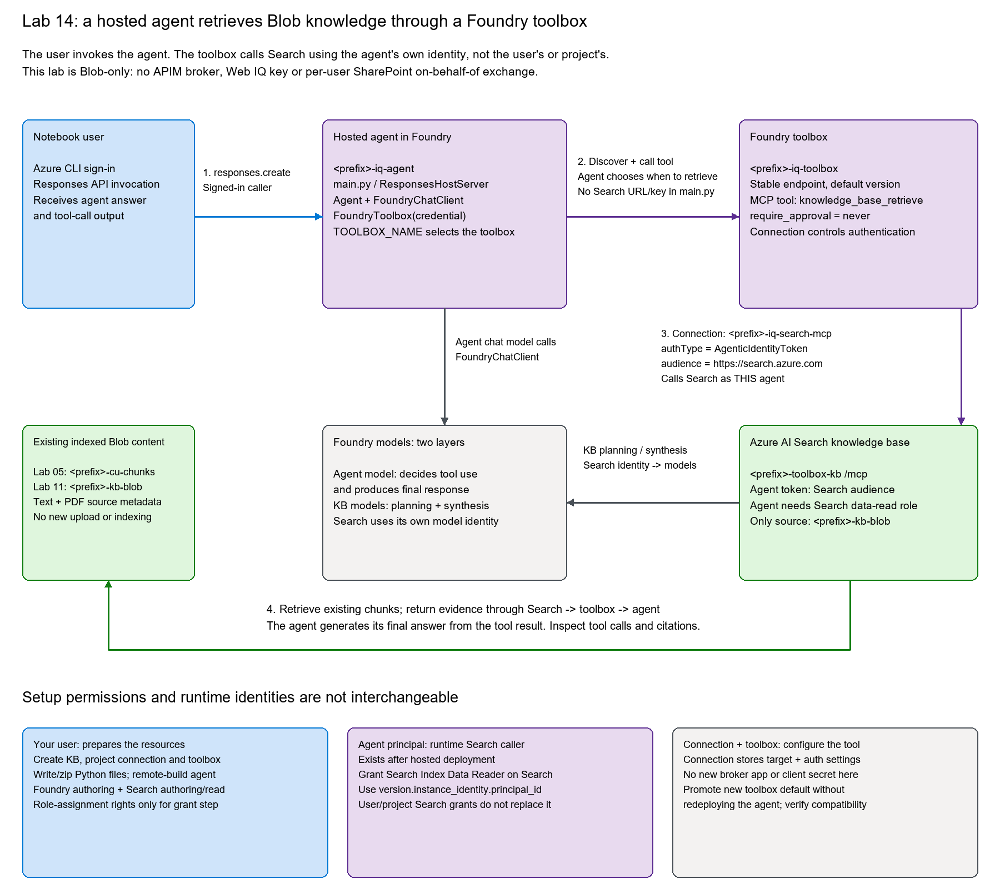

# Lab 14 - A C# hosted agent using Foundry IQ through a toolbox

[C# notebook](../../c-sharp-notebooks/14-foundry-iq-toolbox-agent.ipynb) | [Python lab](../../python-notebooks/14-foundry-iq-toolbox-agent.ipynb) | [Lab 11 console](../11-foundry-iq-knowledge-base/README.md) | [Lab 13 console](../13-hosted-agent/README.md)

The **.NET 10 console app** follows Python14's Blob-only knowledge base -> agentic project connection -> versioned toolbox -> hosted agent -> agent Search grant -> grounded questions. The hosted application is **C#**, not Python. The launcher uses only .NET libraries; Foundry restores the generated host's pinned NuGet packages. No Python, Docker, ACR, `azd`, Web IQ key, APIM broker, new app registration or ingestion is needed.

Run from the repository root:

```powershell
dotnet run --project .\c-sharp-console-apps\14-foundry-iq-toolbox-agent -- --help
dotnet run --project .\c-sharp-console-apps\14-foundry-iq-toolbox-agent -- run
```

**`run` writes resources, deploys a version, tries the Search role assignment and makes two model-backed calls.** It stops with exit code **3** before asking questions if the grant returns HTTP 403. It never retries questions or cleans up automatically. Role propagation can delay the first successful call; after an administrator grants access, run `invoke` explicitly.

## Prerequisites and settings

Complete **lab 11 in either language with the same prefix**, preserving `<prefix>-kb` and `<prefix>-kb-blob`. The Blob source normally references lab 05's `<prefix>-cu-chunks` index. This lab reads the source/model settings and creates a separate KB; no source/index is updated or reingested. Lab 12 is not a prerequisite. Confirm the **C# hosted remote-build** path from lab 13 works in your existing project; Python hosting availability does not prove .NET runtime availability.

| Identity | Permissions / purpose |
|---|---|
| **Your user** | Foundry Owner on the parent Foundry resource, including project connection write and hosted authoring/invocation; Search Service Contributor + Search Index Data Reader or Contributor on Search. Sign in with `az login --tenant <AZURE_TENANT_ID>`. |
| **Your user or administrator assigning roles** | Role-assignment permission on the Search service, such as Role Based Access Control Administrator at that scope. Foundry/Search authoring roles alone do not grant this. |
| **This deployed agent's principal** | **Search Index Data Reader on the Search service**, assigned after deployment. It is not your user or the project's managed identity. The hosted runtime also needs existing model inference access. |
| **Search service identity** | Retain its existing model/indexing grants from earlier labs. KB planning/synthesis uses Search's model access, separately from the hosted agent's model calls. |

Required settings: `WORKSHOP_PREFIX`, `AZURE_TENANT_ID`, `AZURE_SEARCH_ENDPOINT`, `AZURE_SEARCH_RESOURCE_ID`, `AZURE_AI_PROJECT_ENDPOINT`, `AZURE_AI_PROJECT_RESOURCE_ID`, `AZURE_AI_MODEL_DEPLOYMENT_NAME`. Root `.env` loads first, then `.env.azure`; file values override environment values and `.env.azure` wins. The prefix is 3-20 lowercase letters/digits, starting with a letter. Use a tenant GUID, public-cloud HTTPS Search/project endpoints, matching ARM IDs and a model **deployment name**. Endpoint checks reject credentials, query/fragment, nonpublic-cloud hostnames and mismatched endpoint/resource names.

No Web IQ source, per-user SharePoint authorization, Microsoft 365 license, broker consent or client secret is configured here. This is the scope of **this Blob-only example**, not a general limitation of Foundry toolboxes. Prefixes prevent collisions, not enforce data isolation; the agent receives service-scoped Search read access.

## Architecture and the C# equivalent



[Full-size diagram](../../docs/foundry-iq-toolbox-agent-architecture.svg) | [Editable Excalidraw](../../docs/foundry-iq-toolbox-agent-architecture.excalidraw)

The shared diagram labels Python's implementation; the C# implementation maps as follows:

| Python14 | Generated C# host |
|---|---|
| `main.py` / `Agent` / `FoundryChatClient` | `Program.cs` / `AIProjectClient(...).AsAIAgent(...)` |
| `FoundryToolbox(credential)` | `builder.Services.AddFoundryToolboxes(credential, toolboxName)` |
| `ResponsesHostServer(agent).run()` | `AgentHost`, `AddFoundryResponses`, `MapFoundryResponses` |
| Python source zip / `python_3_13` | C# source zip / `dotnet_10`, started with `dotnet WorkshopIqAgent.dll` |

`TOOLBOX_NAME` selects your toolbox's **default version**. The C# hosting layer connects to the managed proxy, discovers tools and supplies them to the agent; the process does not hardcode a Search URL, knowledge-base name or retrieval function. The downstream project connection uses **`AgenticIdentityToken`**, audience `https://search.azure.com`, to call Search as **this agent**. No user Search token, `x-ms-query-source-authorization` or elevated-read header is forwarded.

The hosted agent and KB have separate model layers and costs. Search retrieves indexed chunks; it does not fetch each original PDF for every question. Printed original-document links still require the viewer's own access; an agent's Search grant is not a grant to view the original Blob.

## Run one step at a time

| Command | What happens | Result / prerequisites |
|---|---|---|
| `verify-sources` | Read lab 11's Blob source and KB model settings; verify the source is an indexed source and models exist. | Two metadata reads only. Does not create an index, source or KB, retrieve document content or call a model. |
| `knowledge-base` | Perform those reads, then create/update `<prefix>-toolbox-kb` with only the existing Blob source. | Copies lab 11 models/answer instructions; `answerSynthesis` and **low** reasoning, matching current Python14. No reingestion. |
| `connection` | Check the existing Blob-only KB, then create/update `<prefix>-iq-search-mcp` through ARM. | `RemoteTool`, `AgenticIdentityToken`, Search audience, exact KB MCP target; no key or user token in the definition. Does not modify the old shared connection. |
| `toolbox` | Read/check the existing connection, publish one MCP version of `<prefix>-iq-toolbox`, read the default and promote the new version if necessary. | Requires `connection`; does not repair it silently, deploy the agent or execute tools. `require_approval=never` removes prompts, not authorization. |
| `check-toolbox` | Read/check the existing connection, toolbox default and immutable version's tool settings. | Three metadata reads; no publication, MCP tool execution or document query. |
| `write-agent` | Write `Program.cs` and `WorkshopIqAgent.csproj` locally. | No token/Azure call. **Overwrites these two files**; use `package` after edits instead. |
| `package` | Zip only those two existing source files, at the archive root. | Preserves edits; excludes `.env`, `bin`, `obj`, keys and unrelated files. Requires source writing once; no installs or Azure calls. |
| `deploy` | Validate the existing zip, check toolbox/connection metadata, hash/upload the zip with the hosted definition. | Creates one immutable hosted version; no implicit setup writes, packaging, polling, role grant or question. |
| `status [version]` | Read the specified version or the existing agent's latest version. | Read-only provisioning/identity metadata. |
| `wait [version]` | Select the existing latest version if no ID is supplied, then poll that fixed version every 15 seconds for at most 15 minutes. | Stops on active/failure/deletion/timeout; no deployment or model call. Use the ID printed by `deploy` to monitor that deployment. |
| `grant-search [version]` | Read the active hosted version/principal and try a service-scoped Search Index Data Reader assignment. | Only the **agent principal** is granted access. HTTP 403 prints administrator handoff and exits 3. A verified existing assignment is reused. No model call. |
| `invoke [question] [--diagnostics]` | Make one request to the hosted Responses endpoint, defaulting to the travel-policy question. | Requires runnable agent and propagated Search access. Print answer, session ID, tool item types/names and returned URL annotations; optional bounded tool-result diagnostics can contain internal text. |
| `invoke-unknown [--diagnostics]` | Ask the capital-of-Australia negative-control question once. | Check whether the model follows the policy-only instructions; no source/filter changes or guaranteed refusal. |
| `run [--diagnostics]` | Execute the whole setup/source-writing/packaging/deployment/wait/grant flow and both questions. | Separate commands are not prerequisites; no local cache. Stops before questions on grant handoff. Overwrites generated code and publishes versions on each run. |
| `cleanup --confirm` | Preflight the existing named resource definitions, then delete this agent, toolbox, prefixed connection and KB. | No force-delete; HTTP 409 stops before dismantling the remaining tool chain. Already-missing resources are skipped. Lab 11 resources, index, service/model, Search role assignments and local files are retained. |
| `help`, `--help`, `-h` | Show commands before configuration or authentication. | Fully offline; no settings/cache reads or side effects. No arguments also displays help. |

```powershell
dotnet run --project .\c-sharp-console-apps\14-foundry-iq-toolbox-agent -- verify-sources
dotnet run --project .\c-sharp-console-apps\14-foundry-iq-toolbox-agent -- knowledge-base
dotnet run --project .\c-sharp-console-apps\14-foundry-iq-toolbox-agent -- connection
dotnet run --project .\c-sharp-console-apps\14-foundry-iq-toolbox-agent -- toolbox
dotnet run --project .\c-sharp-console-apps\14-foundry-iq-toolbox-agent -- check-toolbox
dotnet run --project .\c-sharp-console-apps\14-foundry-iq-toolbox-agent -- write-agent
# Optional local build; replace alice01 with your prefix. Needs NuGet, not Azure sign-in.
dotnet build .\alice01-csharp-hosted-agent-iq\WorkshopIqAgent.csproj
dotnet run --project .\c-sharp-console-apps\14-foundry-iq-toolbox-agent -- package
dotnet run --project .\c-sharp-console-apps\14-foundry-iq-toolbox-agent -- deploy
dotnet run --project .\c-sharp-console-apps\14-foundry-iq-toolbox-agent -- wait
dotnet run --project .\c-sharp-console-apps\14-foundry-iq-toolbox-agent -- grant-search
dotnet run --project .\c-sharp-console-apps\14-foundry-iq-toolbox-agent -- invoke
dotnet run --project .\c-sharp-console-apps\14-foundry-iq-toolbox-agent -- invoke "What is our travel reimbursement policy?" --diagnostics
dotnet run --project .\c-sharp-console-apps\14-foundry-iq-toolbox-agent -- invoke-unknown
```

Commands work independently against existing resources and make only their named writes plus necessary metadata reads. No credential/answer/session cache is persisted; `status`, `wait`, `grant-search` can read/select existing latest metadata after a restart. Agent invocation follows the **agent name's endpoint routing**, as Python14 does. A version selected for polling does not pin a Responses call; inspect routing if it was customized outside the lab.

## Source code, versions and identities

### Optional legacy notebook

The linked C# notebook is self-contained: set its kernel working directory to `c-sharp-notebooks`,
then run inline setup and the explained KB/connection/toolbox/source/package/deploy/wait/grant/question cells.
The local notebook uses BCL helpers, not console imports or local SDK packages. The generated hosted C# agent
uses the pinned NuGet dependencies. A denied grant prints the administrator handoff and stops execute-all
before questions; after the administrator confirms Search access, continue with invocation without redeploying
or rerunning a denied grant. Cleanup defaults to false; clear outputs before sharing.

### Generated source and runtime

Azure names match Python14: `<prefix>-toolbox-kb`, `<prefix>-iq-search-mcp`, `<prefix>-iq-toolbox`, `<prefix>-iq-agent`. Generated C# source goes in **`<prefix>-csharp-hosted-agent-iq`**, leaving Python's `<prefix>-hosted-agent-iq\main.py` untouched. Reusing the prefix means both languages publish versions under the **same Azure agent/toolbox names**, not separate agents; use another prefix and matching lab 11 resources for independent instances.

The generated host follows the official [C# server-side toolbox sample](https://github.com/microsoft-foundry/foundry-samples/tree/main/samples/csharp/hosted-agents/agent-framework/foundry-toolbox-server-side) with its concrete hosting/projects NuGet versions. There is no local `@tool`/`AIFunctionFactory` retrieval function. `AsAIAgent` configures the chat model and policy/evidence instructions; `AddFoundryToolboxes` registers the managed tool source using `TOOLBOX_NAME`. The platform supplies `FOUNDRY_PROJECT_ENDPOINT` and runtime identity; deployment sends only the model name and toolbox name, not reserved `FOUNDRY_*` values or secrets.

Deploy uses multipart `metadata` JSON plus `code` zip, SHA-256 integrity header, `kind=hosted`, `.NET 10` remote build, Responses `2.0.0`, CPU `0.5`, memory `1Gi`. Wire shapes follow the installed Python `azure-ai-projects` SDK. Toolbox APIs use `v1`; Search uses `2026-08-01-preview`; ARM connections use `2025-04-01-preview`. Your user acquires separate Foundry, Search and ARM audience tokens through Azure CLI. SDK `.default` scopes correspond to the CLI resource values; none are copied into runtime definitions.

A **toolbox version is immutable**; the agent resolves the stable default. Publishing/promoting a compatible default can update the managed tool route without rebuilding agent code. C# tool discovery occurs in the hosting layer at startup; do not assume existing warm sessions instantly rediscover changed schemas. Use fresh sessions/restart as needed, and redeploy code when its contract changes.

## Grant the right principal

`instance_identity.principal_id` comes from this deployed hosted version, after it is active. The [Search Index Data Reader built-in role](https://learn.microsoft.com/azure/search/search-security-rbac) is `1407120a-92aa-4202-b7e9-c0e197c71c8f`. The assignment is scoped to **the Search service**, not the subscription/project/user. Its deterministic UUIDv5 matches Python14's scope/principal/role naming, so rerunning targets the same assignment.

HTTP 403 is an **administrator handoff**, not successful access. The app prints the principal and Search scope plus the existing helper:

```powershell
.\scripts\grant-agent-search-access.ps1 -PrincipalId <printed-agent-principal-id>
```

The administrator must confirm the helper's environment file identifies the printed Search service. An arbitrary HTTP 409 is not considered success: for `RoleAssignmentExists`, the app reads assignments filtered by that principal and verifies the exact reader role/service scope; otherwise it stops. Role propagation is not instant and is not retried with billable questions.

## Inspect grounding honestly

**Active** means provisioned, not runtime-ready. A successful question proves the application answers, not that every claim is grounded. Inspect MCP/function output, errors and source citations. The app reports visible non-empty `knowledge_base_retrieve` results, or explicitly says no successful retrieval is visible. It does not infer an authentication failure merely from "I don't know", missing references or a model choosing not to retrieve.

The unknown question tests behavior outside the documents; it is not a mathematical proof of grounding. If the model answers from general knowledge, discuss that instruction-following failure and compare tool output. Do not silently accept it as a supported document answer.

HTTP failures print status, UTC Date, available request/correlation IDs and a bounded bearer-redacted body before exiting nonzero. Invalid JSON, partial/incomplete responses, approvals, explicit tool errors and failed builds are not empty successes. `--diagnostics` prints bounded tool records from the same response; it makes **no additional request** and may reveal internal document passages. Returned URL annotations are printed when present, without inventing source URLs or assuming private-document access. Questions use `store=false` without `model` or prior-session selectors; this is not a guarantee of zero platform telemetry/session retention.

## Cleanup and costs

```powershell
dotnet run --project .\c-sharp-console-apps\14-foundry-iq-toolbox-agent -- cleanup --confirm
```

Preflight verifies the prefixed hosted workshop agent, toolbox's KB/connection/policy, connection target/auth and Blob-only KB before deleting anything. If definitions have been repurposed, cleanup stops rather than deleting unrelated resources. Only this lab's four named objects are targeted. Active sessions can block agent deletion with HTTP 409: close them through Foundry and rerun explicitly; there is no `force=true`. Do not remove lab 11's source/base or the existing index while this exercise needs them. Independent Search role assignments are not deleted by this helper; administrators can review obsolete grants separately.

Hosted compute/sessions, Search usage, KB planning/synthesis and the hosted agent's model calls can incur charges. Closing the terminal/editor does not stop Azure resources. Source writing and packaging are local; setup metadata calls do not query documents.

## Offline checks

```powershell
dotnet build .\c-sharp-console-apps\14-foundry-iq-toolbox-agent\IqToolboxAgent.csproj
dotnet run --project .\tests\c-sharp-iq-toolbox
$env:PYTHONPATH = '.\tests'
.\.venv\Scripts\python.exe -m unittest test_csharp_iq_toolbox_notebook.IqToolboxConsoleTests test_csharp_iq_toolbox_notebook.IqToolboxNotebookTests -v
dotnet format .\c-sharp-console-apps\14-foundry-iq-toolbox-agent\IqToolboxAgent.csproj --verify-no-changes --no-restore
dotnet format .\tests\c-sharp-iq-toolbox\IqToolboxTests.csproj --verify-no-changes --no-restore
```

Synthetic HTTP/credentials cover isolated commands, current Python14 payload/UUID parity, promotion, archive contents/hash, fixed-version polling, per-agent grants, admin handoff, error redaction, negative controls and cleanup scope. The tests execute the actual inline notebook cells and locally compile the generated C# toolbox host. Notebook checks additionally use the existing Python test environment and optional deprecated `.NET Interactive`; generated-host compilation needs the configured NuGet feed. None deploys or invokes a live Azure resource.
