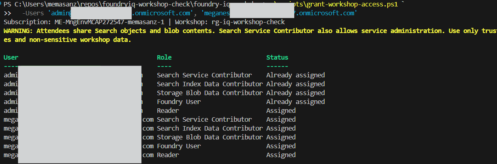

# Facilitator guide

[Workshop home](../../README.md) | [Preparation and permission matrix](../../PREPARE-FOR-WORKSHOP.md) | [Participant handoff](../participants/README.md)

Choose the labs before requesting tenant consent, licenses or gateway changes.
The [beginner deployment guide](../../infra/README.md) explains Azure tools and provisioning in detail.
Run commands from the repository root, not from this documentation folder.
The examples use PowerShell 7 and Azure CLI.

## What you need

Facilitators additionally need:

- Bicep (`az bicep version`); use the [deployment guide](../../infra/README.md) if a tool is missing.
- A **paid Azure subscription** where you can create resources. The current [Web IQ deployment prerequisites](https://learn.microsoft.com/web-iq/get-started/deploy-azure-portal) do not list prior access approval. Azure credits do not work for Web IQ. The deployment script registers the required resource providers.
- Permissions to create resources and role assignments. The deployer normally needs Owner, or Contributor plus Role Based Access Control Administrator. The script resolves the signed-in user's object ID; service-principal deployments must pass a participant user's `-PrincipalId`.
- Foundry model quota in the selected region. Defaults: `gpt-5-mini`, version `2025-08-07`, GlobalStandard capacity `30`. Adjust the script parameters if the model/version is unavailable. GlobalStandard can process inference outside the selected Azure region.
- Access to the [Web IQ portal](https://webiq.microsoft.ai/profiles). Review the [Web IQ terms](https://www.microsoft.com/en-us/webiq/webiq-legal) before making requests.

### Arrange these before class

The full resource and permission matrix is in [Prepare for the workshop](../../PREPARE-FOR-WORKSHOP.md). These are the most common blockers:

| Labs | What must be ready |
|---|---|
| 01-03 | A paid Azure subscription, a deployed Web IQ resource, and a linked profile/API key. Workshop onboarding grants participants **Foundry Owner on the parent Foundry resource** for connection, agent and toolbox authoring. Notebook 02 also documents its narrower sufficient role. |
| 04-06 | Search, the embedding deployment and inference access. Notebooks 04-05 also need authenticated network access to Blob Storage. Notebook 06 needs account-level embedding permission; project-only Foundry User is insufficient. |
| 05, 07 | A Content Understanding-supported Foundry region (East US recommended), **Cognitive Services User for Search's identity on Foundry**, and budget for document analysis and embeddings. Bicep already declares this role. |
| 07 | SharePoint indexer preview registration, one shared Entra ingestion app, **tenant admin consent**, and an explicit test-site grant. Graph `Files.Read.All` is tenant-wide file-read access; obtain approval before class. |
| 08 | **Microsoft 365 Copilot add-on license for each querying user**, or explicitly enabled Retrieval API pay-as-you-go. Pay-as-you-go requires at least one Copilot license in the tenant. GitHub Copilot is not a substitute. |
| 10 | An **existing APIM service**, its managed-identity Search access, and the separate broker app/policy setup below. Bicep does not create APIM. |
| 14 | Existing Search and chat deployment, Search authoring/query access, Search identity's model access, and `WEBIQ_API_KEY`. The separate Web IQ source stores its key for direct notebook and portal queries. No document ingestion or APIM setup is required. |
| 03, 11-12 | Verify toolbox/hosted-agent preview availability in your project and region. Successful infrastructure deployment does not prove these notebook flows work end to end. |

Use only a dedicated SharePoint test site and non-sensitive documents. Never weaken tenant security policies to make an exercise work.

## Setup order

**Facilitator setup order** (complete the steps needed for your chosen labs):

1. [Deploy](#1-deploy).
2. [Set up the SharePoint app registration and administrator approval](sharepoint.md#2-set-up-the-sharepoint-app-registration-facilitator-before-the-workshop).
3. [Complete Web IQ onboarding](#3-complete-web-iq-onboarding).
4. [Set up the APIM gateway](#4-set-up-the-apim-gateway-facilitator-before-the-workshop-notebook-10).
5. [Set up the toolbox connection](#5-toolbox-connection-and-agent-access-notebook-12).
6. [Grant attendee access](#6-grant-attendee-access).
7. [Open the notebooks](../participants/README.md).


## 1. Deploy

**Facilitator only.** Participants using shared workshop resources can skip to [local setup](../participants/README.md). For a step-by-step explanation, see [Deploy the workshop resources](../../infra/README.md).

From the workshop directory:

```powershell
az login
.\scripts\deploy.ps1 `
  -SubscriptionId '<your-subscription-id>' `
  -ResourceGroup 'rg-iq-workshop' `
  -Location 'eastus' `
  -SearchSku 'standard'
```

The script targets the subscription you specify without changing your CLI default. It creates the group if needed, deploys the resources, and ensures the **live Foundry project identity** has Search Index Data Reader. Reruns skip a matching grant. Add `-WhatIf` to preview changes in an **existing** group without deploying or updating settings.

### Know your configuration files

| File | Who maintains it? | What belongs here? |
|---|---|---|
| `.env.azure` | Deployment script, automatically after success | Deployed endpoints, resource IDs, locations and model deployment names |
| `.env` | You; deployment does not overwrite it | Web IQ key, unique participant prefix, SharePoint settings and existing APIM resource ID |
| `.deployment\deployment.json` | Deployment script | Local deployment result and outputs |

All three are excluded from Git. A failed deployment leaves the previous `.env.azure` unchanged, although some Azure resources may already exist. **Do not copy generated endpoints into `.env`**: its values load first and can hide the new settings. Restart notebook kernels after redeployment.

Before the remaining facilitator setup steps, create your local settings file without replacing an existing one:

```powershell
if (-not (Test-Path .\.env)) { Copy-Item .\.env.example .\.env }
```

The deployment grants the facilitator project-level Foundry User, Search administration/data access, and Blob data access. It also grants the required Search-to-Blob, Search-to-Foundry and project-to-Search access. It does **not** create notebook connections, indexes, agents, tenant app registrations or the participant parent-resource Foundry Owner grant.

**Changing region creates new regional resources; it does not move or delete the old ones.** Old resources can keep billing. A group's metadata location can differ from its resources' location. Recreate region-dependent connections/agents and update SharePoint federation and the existing APIM backend/access grants afterward. Web IQ stays global and APIM can stay in its current region.

If policy disables Storage public networking, obtain the approved exception for the **new account** and verify authenticated connectivity. An old account's exemption does not transfer. Keep anonymous Blob access and shared keys disabled. More detail is in the [deployment guide](../../infra/README.md).

Use a **dedicated** resource group: whole-group cleanup deletes everything inside it.


## 2. Set up the SharePoint app registration (facilitator, before the workshop)

Follow the [SharePoint setup and administrator handoff](sharepoint.md) for indexed lab 07. Remote lab 08 does not need this ingestion app.


## 3. Complete Web IQ onboarding

1. Open [Profile Management](https://webiq.microsoft.ai/profiles), sign in, and link the `WEBIQ_RESOURCE_ID` from `.env.azure`.
2. Create an API key. This portal step is **not automated by the Azure resource deployment**.
3. Set `WEBIQ_API_KEY` in your untracked `.env`, or use the notebooks' hidden password prompt. Local setup below creates `.env` without overwriting an existing file. Never put credentials directly in a notebook cell.
4. Notebook 01 calls Web Search, Browse, News, Images and Videos directly with the profile API key. There are no notebook-level service switches; API permission errors remain visible.

Web IQ API keys are not Azure Cognitive Services keys and are not retrieved with `az cognitiveservices account keys list`. Production Web IQ Entra authentication uses an **app-only** token and a client ID bound to the Web IQ profile; `az login` alone does not authenticate a Web IQ REST call. The notebooks use a Web IQ API key and Entra credentials for Foundry.


## 4. Set up the APIM gateway (facilitator, before the workshop; notebook 10)

Notebook 10 calls the knowledge base through an **existing Azure API Management service**, using a **different app registration** from the SharePoint one. Bicep does not create or configure the gateway. It can be in another resource group or subscription in the same tenant and does not have to move to East US. Keep it outside the dedicated workshop resource group if you intend to run the whole-group cleanup and retain the gateway. Before running the scripts, enable its **system-assigned managed identity** and grant that identity **Search Index Data Reader** on the workshop Search service. The facilitator needs permission to configure APIM, create the broker app, grant this Search role, and **Search Service Contributor** on Search to create the shared Web IQ source.

Set your existing gateway's resource ID in the untracked `.env` file. Both setup scripts read it; the gateway is not a Bicep deployment parameter:

```dotenv
APIM_RESOURCE_ID=/subscriptions/<apim-subscription-id>/resourceGroups/<apim-resource-group>/providers/Microsoft.ApiManagement/service/<existing-apim-name>
```

On the workshop Search service, use **Access control (IAM) -> Add role assignment -> Search Index Data Reader**, select **Managed identity**, and choose the existing APIM service's system-assigned identity. This replaces the role assignment previously made by Bicep.

Run these after `scripts\deploy.ps1` and the identity/role preparation:

```powershell
.\scripts\setup-broker-app.ps1 -GrantAdminConsent
.\scripts\setup-apim-policy.ps1  # reads WEBIQ_API_KEY from .env or prompts
```

The setup scripts target only this gateway's workshop API and named values, not the APIM service's SKU, location or identity configuration. They reuse or overwrite `iq-knowledge-base` and the named values `broker-client-secret`, `broker-client-id`, `tenant-id` and `webiq-api-key`; obtain approval and check for naming collisions before using a shared gateway. Use `-WhatIf` to preview script changes. Allow time for the Search role assignment to propagate.

<details>
<summary>What the broker and policy scripts configure</summary>

`setup-broker-app.ps1` (supports reruns and `-WhatIf`):

1. Creates the single-tenant app `iq-workshop-apim-broker` and its service principal.
2. Exposes the delegated scope `api://<appId>/user_impersonation` and **pre-authorizes Azure CLI** for it, so attendees get a token with `az login` and no consent prompt.
3. Requests the delegated **Azure Cognitive Search `user_impersonation`** permission (looked up by name). `-GrantAdminConsent` consents tenant-wide; otherwise approve it in Entra.
4. Creates a one-year client secret and stores it **only** as the secret APIM named value `broker-client-secret`. It is never printed or written to disk. Use `-RotateSecret` to replace it. It also stores `broker-client-id` and `tenant-id`.
5. Prints `BROKER_APP_CLIENT_ID` for `.env`.

`setup-apim-policy.ps1` stores the Web IQ key as the secret named value `webiq-api-key`, creates the API `iq-knowledge-base` (path `/iq`, `retrieve` and `mcp` operations in front of Search), and sets this policy on every call:

| Step | What it does |
|---|---|
| `validate-jwt` | Accepts only Entra tokens for the broker app with scope `user_impersonation`; otherwise 401 |
| On-behalf-of | Exchanges the caller's token for an Azure AI Search token for the **same user** and sends it as `x-ms-query-source-authorization`, so SharePoint ACLs and remote SharePoint run as that user |
| Web IQ key | Adds `<source>-header-name` / `-header-value` control headers from the named value; the key never reaches attendees |
| Elevated read | Deletes any caller-supplied `x-ms-enable-elevated-read` header, which would bypass ACLs |
| Managed identity | Replaces `Authorization` with the APIM identity's Search token |

</details>

APIM charges depend on the existing gateway's tier. Because header names embed the source name, the policy is written for **one shared Web IQ source** (`-WebIqSourceName`, default `iq-workshop-webiq`). `setup-apim-policy.ps1` creates or updates it once during facilitator setup; notebook 10 only reads it, so attendees do not overwrite shared configuration. Existing workshops should rerun that script before notebook 10 if the source is missing. Give attendees `BROKER_APP_CLIENT_ID`, `APIM_GATEWAY_URL` and `WEBIQ_APIM_SOURCE_NAME` (printed by the scripts). The APIM named-value secrets are visible to anyone with APIM contributor access; use Key Vault references for production.


## 5. Toolbox connection and agent access (notebook 12)

Notebook 12 creates or updates each user's `{prefix}-iq-search-mcp` project connection directly in Python before creating the toolbox. No pre-created connection, `TOOLBOX_CONNECTION_NAME` setting or separate connection setup script is required. The signed-in user needs project connection-write permission (`Microsoft.CognitiveServices/accounts/projects/connections/write`), included in the workshop's Foundry Owner grant.

The connection targets that user's knowledge-base MCP endpoint with `AgenticIdentityToken` authentication and audience `https://search.azure.com`. Foundry calls Search as the agent, not the user or project identity; no secret is stored. Opt-in cleanup removes the user's connection along with the agent, toolbox and knowledge base.

The existing `setup-toolbox-connection.ps1` remains available for optional shared-connection setups, but notebook 12 no longer uses its shared connection.

**Per-agent access.** The agent calls Search as its own Entra identity, created when the agent is deployed, so it cannot be granted in advance. Notebook 12 prints the identity's principal ID and tries to assign **Search Index Data Reader** (read-only, Search service scope) itself. Attendees normally cannot assign roles, so expect to run, with the printed IDs:

```powershell
.\scripts\grant-agent-search-access.ps1 -PrincipalId <id1>,<id2>
```

To skip this per attendee, you could instead give attendees a constrained *Role Based Access Control Administrator* role (limited to Search Index Data Reader) on the Search service; this workshop does not do that by default.


## 6. Grant attendee access

After deployment, run the permissions script as an administrator with role-assignment write permissions on the workshop resources, such as Owner or Role Based Access Control Administrator. Azure subscription Contributor alone cannot grant roles. The script also needs directory access to resolve the specified Microsoft Entra users.

```powershell
# Preview first; this reads identities and assignments but does not grant access.
.\scripts\grant-workshop-access.ps1 `
  -Users 'attendee1@contoso.com', 'attendee2@contoso.com' `
  -WhatIf

# Assign the workshop roles.
.\scripts\grant-workshop-access.ps1 `
  -Users 'attendee1@contoso.com', 'attendee2@contoso.com'

# A text file can supply one user principal name or user object ID per line.
.\scripts\grant-workshop-access.ps1 -Users (Get-Content '.\attendees.txt')
```

Example output showing newly assigned roles and existing assignments (user details redacted):



`-Users` accepts Microsoft Entra user principal names or user object IDs in the deployment tenant, not arbitrary contact email addresses. Invite external attendees as guests first, then use their **guest object IDs in the workshop tenant**. The script does not create users or send guest invitations. Do not commit attendee rosters to source control.

The script reads resource IDs from `.env.azure`, validates that the scopes belong to its workshop resource group, resolves all attendees before making changes, and skips identical existing direct assignments. It targets the configured subscription without changing your CLI default. Use `-EnvironmentFile` to select another deployment's generated settings.

| Role | Scope | Enables |
|---|---|---|
| Search Service Contributor | Workshop Search service | Create/manage indexes, indexers, data sources, skillsets and other Search objects |
| Search Index Data Contributor | Workshop Search service | Upload, update and delete documents; run queries |
| Storage Blob Data Contributor | `workshop-documents` container only | Upload, read and delete source documents |
| Foundry Owner | Parent workshop Foundry resource (inherited by its projects) | Create/manage connections, toolboxes and agents; account-level model management and inference |
| Reader | Web IQ resource (only if `WEBIQ_RESOURCE_ID` is in `.env.azure`) | View the resource in the portal; read-only |

**Foundry authoring is included:** the script grants **Foundry Owner on the parent Foundry resource**, so every attendee can create their own connections, toolboxes and agents. This also covers notebook 06's direct account-level embedding calls. It replaces the script's former project-only Foundry User grant; rerun it for existing attendees to add Foundry Owner. Existing Foundry User assignments are not revoked. Notebook 02's narrower Foundry Project Manager role is sufficient for that lab, but this script deliberately uses the broader role for the full workshop.

These roles do not grant subscription/resource-group Contributor or Owner, SharePoint access or write access to Web IQ. Foundry Owner does include limited role-delegation permissions within the Foundry resource; it does not grant role-assignment management on Search or other services. Web IQ API access uses a separate profile key.

**Shared-service warning:** participants can modify one another's Search objects and access shared index/blob content. Foundry Owner also permits changes to shared models, connections and projects, including access to connection credentials. A unique prefix prevents name collisions, **not access isolation**. Use trusted attendees and non-sensitive data; separate resources if strict isolation is required. Check Search object limits and capacity for the class size, and allow several minutes for role propagation.


## Before attendees start

Complete the [preparation checklist and live validation](../../PREPARE-FOR-WORKSHOP.md),
then share configuration and point attendees to the [participant guide](../participants/README.md).
Review [costs](../reference/README.md#costs-and-responsible-use),
[validation limits](../reference/README.md#lab-notes-and-validation-limits) and
[facilitator cleanup](../reference/README.md#cleanup), including tenant objects and existing gateways.
