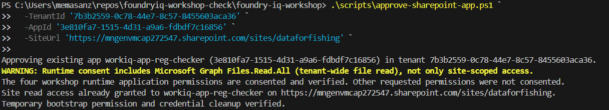

# 2. Set up the SharePoint app registration (facilitator, before the workshop)

Notebook 07's **indexed** path needs an Entra app that Azure AI Search uses to read SharePoint. Run `scripts\setup-sharepoint-app.ps1` once, after deployment, as a user who can create app registrations or update the selected existing app (add `-GrantAdminConsent` only if you also hold a role that can consent). Attendees do not need Entra permissions. The **remote** path needs no app; it runs as each attendee (see notebook 08).

**Permissions required by the person running the script:**

| Operation | Required access |
|---|---|
| Create or update the ingestion app and its federated credential | Permission to register apps, or ownership/admin rights over the existing app, plus Graph authorization for the app-management operations |
| Read Search's system-assigned managed identity | Azure **Reader** on the Search resource, or an inherited/broader role such as Contributor or Owner |
| Grant site access with `-SiteUrl` (default delegated method) | **SharePoint Administrator or Global Administrator**, plus membership of the target SharePoint site |
| Authorize the default site-permission Graph requests | The signed-in Azure CLI token must include delegated **`Sites.FullControl.All`**, even though the app receives only a site-scoped Read grant |
| Bootstrap site access with `-BootstrapSiteAccess` | **Privileged Role Administrator or Global Administrator**, plus Graph authorization to manage application credentials and app-role assignments (for example, `AppRoleAssignment.ReadWrite.All` + `Application.Read.All`, and app-management authorization). Uses an app-only token for the site grant instead of requiring delegated `Sites.FullControl.All`. |
| Grant tenant-wide consent with `-GrantAdminConsent` | **Privileged Role Administrator or Global Administrator**, because this app requests Microsoft Graph application permissions; Application Administrator and Cloud Application Administrator alone cannot consent to those Graph application permissions |

These are the **caller's setup permissions**. Azure subscription Owner alone does not grant SharePoint or Entra administration rights, and an administrator role does not automatically add the required Graph scope to a CLI token. Activate any required PIM roles and sign in with the required authorization before running the script. Bootstrap explicitly adds temporary application access, as described below; it does not bypass administrator authorization.

The Search identity lookup only reads its principal ID so the script can configure the app's secretless federated trust. It does not read Search documents or grant SharePoint access. Existing Contributor or Owner access at the resource, resource-group or subscription scope already covers that lookup; no extra Reader assignment is needed.

Use `-AppName` for the app registration's **exact display name** in the deployment tenant. If one app matches, the script configures that app; if none matches, it creates a new single-tenant app with that name. If multiple apps match, it stops without changing them; use a unique display name. Omitting `-AppName` uses `iq-workshop-sharepoint-indexer`.

#### Administrator handoff: approve permissions and site Read once

The original `setup-sharepoint-app.ps1` **still supports combined setup, consent and site grants**. For a separate administrator handoff, use the additional [`scripts\approve-sharepoint-app.ps1`](../../scripts/approve-sharepoint-app.ps1) entry point:

**Who should run the approval script?** For the simplest handoff, ask a **Global Administrator** to run it once. A Privileged Role Administrator with authority to manage the app's credentials can also run it. Participants do not need these roles afterward.

1. **Facilitator/app owner:** configure the app and Search federation without requesting site access or granting admin consent. This requires app-management permission and Search read access, but not the site-grant administrator role:

   ```powershell
   .\scripts\setup-sharepoint-app.ps1 -AppName 'Workshop SharePoint Indexer'
   ```

   Keep the three printed settings for your local `.env`, and give the administrator the **tenant ID**, the printed **application client ID**, and the **site URL**. Site access and runtime consent remain outstanding at this point.

2. **Authorized administrator:** from the repository root, sign in to that tenant and preview the approval:

   ```powershell
   az login --tenant '<tenant-id>' --allow-no-subscriptions

   .\scripts\approve-sharepoint-app.ps1 `
     -TenantId '<tenant-id>' `
     -AppId '<application-client-id>' `
     -SiteUrl 'https://contoso.sharepoint.com/sites/iq-workshop' `
     -WhatIf
   ```

   Remove `-WhatIf` to approve and verify the four runtime **application** permissions and create/verify the app's site **Read** grant. No separate consent switch is needed: **running this approval script without `-WhatIf` explicitly approves those permissions**.

The administrator needs Azure CLI and Graph authorization to read the app and manage application credentials and app-role assignments. Their administrator role does not automatically supply missing Graph token permissions. They do **not** need Search access, an Azure subscription role, your `.env` or `.env.azure`, or a delegated `Sites.FullControl.All` token. If handing off individual files rather than the repository, send **both** `approve-sharepoint-app.ps1` and its sibling `setup-sharepoint-app.ps1` in the same folder.

**What the approval script does, in order:**

1. Finds the existing app by client ID in the specified tenant and checks that all four workshop application permissions have already been requested.
2. Approves and verifies the runtime **application** permissions: Microsoft Graph `Files.Read.All` and `Sites.Selected`; SharePoint `Sites.Selected` and `User.Read.All`.
3. Temporarily grants Microsoft Graph **application `Sites.FullControl.All`** and creates a **15-minute credential**.
4. Uses an **app-only token**, not delegated SharePoint authorization, to grant and verify **Read on the specified site**, or reuse an existing readable grant.
5. Removes the temporary permission and credential it added, then verifies their cleanup.

**What remains afterward:** the four runtime application consent grants and the site's Read grant. The script does **not** create an app, change its manifest or Search federation, or edit `.env` or `.env.azure`. **Graph `Files.Read.All` is tenant-wide file read**, so the app's total access is not limited solely to the selected site.

Example successful approval:



The screenshot's "Site read access already granted" message means the app already had a readable site grant; no duplicate was created. Together with the runtime-consent and cleanup confirmations, it shows that administrator approval succeeded. Use your own tenant, app client ID and site URL, and ensure the notebook configuration points to the **same app** that was approved.

It does not approve unrelated requested permissions or delegated scopes. Existing runtime consents and readable site grants are reused. Existing broader permissions/credentials are preserved, with warnings for broader site grants or pre-existing Graph FullControl. Cleanup runs on success or failure; any cleanup failure reports manual-action instructions. Do not forcibly terminate or concurrently modify this app during bootstrap. Issued tokens can remain valid until expiry after revocation.

The steps can be rerun with the same app client ID and site URL. A later site failure does not roll back runtime consent that already succeeded. After approval, the facilitator runs notebook 07's ingestion and allowed/restricted-user checks; the approval script does not prove end-to-end indexing or ACL enforcement.

#### Combined app and site setup (app-only bootstrap)

For the complete scripted setup, an authorized Global Administrator or Privileged Role Administrator with the required Graph app-management and app-role-assignment authorization runs the following from the repository root, after deployment has generated `.env.azure` and after signing in to that deployment's tenant:

```powershell
.\scripts\setup-sharepoint-app.ps1 `
  -AppName 'Workshop SharePoint Indexer' `
  -SiteUrl 'https://contoso.sharepoint.com/sites/iq-workshop' `
  -BootstrapSiteAccess `
  -GrantAdminConsent
```

Replace the app name and site URL for your tenant. This is the **setup script**: it creates/reuses the app, requests the runtime **application** permissions, configures federation with Search's managed identity, grants runtime admin consent, and creates/verifies the site Read grant using temporary **app-only** FullControl. It then attempts and verifies removal of the temporary permission and credential. No delegated `Sites.FullControl.All` token is used for the site grant. Administrator authorization for managing app permissions and credentials is still required.

Copy the printed `SHAREPOINT_APP_CLIENT_ID`, `SHAREPOINT_APP_OBJECT_ID` and `SHAREPOINT_SEARCH_MI_CLIENT_ID` into your local `.env`. Re-running with the same unique app name, site URL and deployment settings reuses the app, trust and readable site grant. Existing broader permissions are preserved with warnings, so re-running does not enforce least privilege on an already overprivileged app. See the cleanup and token-expiry limitations below.

If you omit `-GrantAdminConsent`, the script still configures the app and site grant, but does **not** approve the runtime API permissions. Configured permissions and a successful site grant alone do not prove the indexer is ready; verify runtime consent and run notebook 07's ingestion and allowed/restricted-user checks.

**Don't want to grant `Sites.FullControl.All` to your CLI session or temporarily to the ingestion app?** Omit both `-SiteUrl` and `-BootstrapSiteAccess`:

```powershell
.\scripts\setup-sharepoint-app.ps1 -AppName 'Existing SharePoint Indexer'
```

This configures the app and Search federation without requiring `Sites.FullControl.All` or inspecting/changing site access. An authorized administrator must separately grant the ingestion app **Read** on the target site before notebook 07 can run; tenant admin consent for the requested API permissions is still required. The ingestion app does not need ongoing `Sites.FullControl.All`. Adding `-SiteUrl` uses delegated FullControl for site-grant setup; adding `-BootstrapSiteAccess` instead uses temporary application FullControl, so bootstrap is not a FullControl-free alternative.

#### Grant site Read separately

Use [`scripts\grant-sharepoint-site-read.ps1`](../../scripts/grant-sharepoint-site-read.ps1) to let an administrator grant site access **after** the app has been configured without `-SiteUrl`. It grants an **existing app** Read on **one site**; it does not configure the ingestion app or Search federation.

After signing in with `az login` to the site's tenant, an authorized administrator can run:

```powershell
.\scripts\grant-sharepoint-site-read.ps1 -AppName 'Existing SharePoint Indexer' `
  -SiteUrl 'https://contoso.sharepoint.com/sites/iq-workshop' -WhatIf

# Apply after reviewing the preview.
.\scripts\grant-sharepoint-site-read.ps1 -AppName 'Existing SharePoint Indexer' `
  -SiteUrl 'https://contoso.sharepoint.com/sites/iq-workshop'
```

| Parameter | Meaning |
|---|---|
| `-AppName` | Exact display name of an existing app in the signed-in tenant; duplicate names cause an error. |
| `-AppId` | Application **client ID**, instead of `-AppName`; not the application or service-principal object ID. |
| `-SiteUrl` | Required SharePoint HTTPS site URL, not a document sharing link. |
| `-WhatIf` | Resolves the app and reads site permissions, but makes no changes; still requires read authorization. |

This standalone script requires Azure CLI, access to read the app registration, and no `.env.azure` or Search access. Its delegated path requires **SharePoint Administrator or higher**, membership of the site, and delegated Graph **`Sites.FullControl.All` in the Azure CLI token**. Global Administrator can approve consent, but the role does not automatically add the scope to a token. The script does not request or consent this scope. Signing in with `Connect-MgGraph` does not authorize Azure CLI; those tools use separate tokens.

The script prints the tenant and app client ID, checks all pages of existing site permissions, creates a missing Read grant, and reads it back to verify the app and role. Existing readable grants are preserved; broader grants produce a warning and are **not** downgraded. An unrecognized existing grant stops the script for manual review rather than creating a duplicate. It does not change API permissions, admin consent, or credentials, and never grants FullControl to the target app.

**A successful site grant is not the whole setup:** tenant admin consent for the ingestion app's API permissions and its Search federation must still be configured. A 403 during site inspection means the caller's authorization needs checking, not that the ingestion app should receive FullControl.

#### Other ways to grant site access

Delegated authorization is **not mandatory for the Graph API itself**. Microsoft documents both delegated and application **`Sites.FullControl.All`** for [`POST /sites/{id}/permissions`](https://learn.microsoft.com/graph/api/site-post-permissions). Choose an approved administration path:

| Path | Who or what authorizes the site grant | Target app's resulting site access |
|---|---|---|
| Standalone script above, or `setup-sharepoint-app.ps1 -SiteUrl` | A SharePoint Administrator or higher with site membership and a delegated FullControl token | Read, unless an existing broader grant is preserved |
| `setup-sharepoint-app.ps1 -SiteUrl -BootstrapSiteAccess` | An authorized Entra administrator temporarily consents **application** FullControl to the ingestion app; the script uses an app-only token and attempts verified cleanup afterward | Read, unless an existing broader grant is preserved |
| Existing approved administration app calling Graph | A separate administration app already consented to **application** FullControl; no delegated user token is required | Read when the administrator posts a `roles: ["read"]` grant |
| PnP PowerShell | [`Grant-PnPEntraIDAppSitePermission`](https://pnp.github.io/powershell/cmdlets/Grant-PnPEntraIDAppSitePermission.html) with `-Permissions Read`; its documented requirement is delegated Graph FullControl | Read for a newly created grant |

The standalone script does **not** implement the app-only path or bootstrap. An administrator can use approved Graph tooling instead; [the Search indexer guide](https://learn.microsoft.com/azure/search/search-how-to-index-sharepoint-online#configure-the-sharepoint-in-microsoft-365-indexer) provides Graph and PnP grant examples. Neither a different tool nor admin consent for `Sites.Selected` removes the need to authorize the explicit site grant. Do not replace site-scoped access with tenant-wide read permissions just to avoid the grant step.

#### Other combined setup examples

```powershell
# Existing app: use its exact display name.
.\scripts\setup-sharepoint-app.ps1 -AppName 'Existing SharePoint Indexer' -SiteUrl 'https://contoso.sharepoint.com/sites/iq-workshop' -WhatIf
.\scripts\setup-sharepoint-app.ps1 -AppName 'Existing SharePoint Indexer' -SiteUrl 'https://contoso.sharepoint.com/sites/iq-workshop' -GrantAdminConsent

# New app: choose a name that does not already exist.
.\scripts\setup-sharepoint-app.ps1 -AppName 'New Workshop SharePoint Indexer' -SiteUrl 'https://contoso.sharepoint.com/sites/iq-workshop'

# Opt-in alternative when the CLI user cannot manage site grants with a delegated token.
# Requires an authorized Entra administrator; temporarily consents tenant-wide Graph FullControl.
.\scripts\setup-sharepoint-app.ps1 -AppName 'Existing SharePoint Indexer' `
  -SiteUrl 'https://contoso.sharepoint.com/sites/iq-workshop' `
  -BootstrapSiteAccess -GrantAdminConsent
```

What it does, in order (safe to re-run; it reuses the app by name and preserves existing API permissions):

1. Reads the Search service's system-assigned managed identity (from `.env.azure`).
2. Reuses the named app, or creates it as single-tenant, and ensures its service principal exists.
3. Requests these **application** permissions, looked up by name:
   - Microsoft Graph: `Files.Read.All`, `Sites.Selected`
   - SharePoint: `Sites.Selected`, `User.Read.All`
4. Adds a **federated credential** that trusts the Search managed identity. No runtime client secret is created; Search proves its identity with its managed identity. Existing credentials on a reused app are left unchanged.
5. With `-GrantAdminConsent`, grants tenant admin consent. Otherwise approve it in Entra > App registrations > API permissions.
6. Prints the three values for `.env` (`SHAREPOINT_APP_CLIENT_ID`, `SHAREPOINT_APP_OBJECT_ID`, `SHAREPOINT_SEARCH_MI_CLIENT_ID`).

With `-SiteUrl`, the script resolves the site, grants the **ingestion app** site-scoped **Read** through Microsoft Graph, and reads the grant back to verify it. Existing grants that already allow reading are reused; broader grants are left unchanged with a warning, not automatically downgraded. It does not create another app or require PnP PowerShell. Without `-SiteUrl`, it configures only the app and warns that site access is still outstanding. `-WhatIf` makes no changes.

In the default delegated method, the script checks site access before making app changes and stops with an explanation if the caller is unauthorized.

**What is temporarily elevated, and why?** Only with `-BootstrapSiteAccess`, the script temporarily grants the ingestion app the **Microsoft Graph `Sites.FullControl.All` application permission**, which allows tenant-wide SharePoint FullControl. Graph requires this permission to **create the site's Read grant**: assigning access requires more privilege than reading documents. The temporary elevation is for setup, not the indexer's normal document-reading operation. **`-GrantAdminConsent` alone does not enable this temporary elevation.**

Bootstrap consents the role directly on the ingestion app's service principal, creates a **15-minute credential**, and uses the resulting app-only token to create and verify the site-specific **Read** grant. It does not add FullControl to the app's requested-permissions manifest. The credential and token stay in memory and are not printed or written to `.env`. Runtime consent for the four requested permissions is still separate (`-GrantAdminConsent`). After successful cleanup, the new site grant remains **Read**, not FullControl.

Bootstrap attempts cleanup in `finally` on success or failure: it revokes only the new temporary role assignment, removes only its uniquely named temporary credential, and verifies both removals. Pre-existing permissions and credentials are preserved, with a warning if tenant-wide FullControl was already granted. Avoid concurrent permission changes to this app: if the role-creation response is lost, cleanup identifies new matching assignments by comparison with the pre-run snapshot. Cleanup failure stops the script with explicit manual-action instructions; forcibly terminating the process can prevent cleanup. Issued access tokens can remain valid until expiry even after the permission and credential are removed. The indexer remains secretless. If an existing site's grant roles do not confirm read access, either method stops rather than creating a duplicate or revoking it.

The [Search ACL permission matrix](https://learn.microsoft.com/azure/search/search-indexer-sharepoint-access-control-lists#permissions-by-acl-scenario) documents `Sites.Selected` and an explicit site grant, but does not specify the minimum site-grant role for every ACL scenario. This script uses **Read**; verify ACL extraction and two-user query behavior rather than assuming that a successful content-ingestion run proves ACL support. Do not automatically escalate to FullControl. Caveat: Graph `Files.Read.All` remains tenant-wide read, so this is not strict site-only isolation. Use a test tenant or non-sensitive content. The notebook's own app-creation and federation-check cells stay disabled by default; this script replaces them for facilitators.

Notebook 07 follows the [setup-index reference](https://github.com/memasanz/foundry-iq-sharepoint-indexer/blob/main/notebooks/01_setup_index.ipynb), keeping Content Understanding semantic text sections, embeddings, source/page metadata and Entra ACL projections, but omitting all Vision/image processing. Its separate `{prefix}-nb7-*` objects leave older `{prefix}-sp-*` resources unchanged. The shared app setup script still provisions optional native-group API permissions; notebook 07 only uses the Graph document-library ACL path and does not resolve native SharePoint groups.

Before class, use two non-admin member users to test an allowed and a restricted document through direct user access and an Entra group assigned directly to the document. Remove direct user access before a group-only test. Start with `*` so keyword mismatch does not obscure permission checks. Browser access through site ownership, special owners claims or nested SharePoint groups is not proof of an equivalent supported Search access path. Inherited ACL changes need a permissions resync and an indexer run. Review the preview limitations, including guest users, nested groups and Conditional Access compatibility.

**Using notebook 08 instead?** Skip this ingestion app setup. Queries run as each signed-in user and require their Microsoft 365 Copilot license or explicitly enabled Retrieval API pay-as-you-go. This billing is separate from Search/Foundry. Verify the documents are available in Microsoft 365 search before class.

[Facilitator guide](README.md) | [Preparation and permission matrix](../../PREPARE-FOR-WORKSHOP.md) | [Workshop home](../../README.md)
